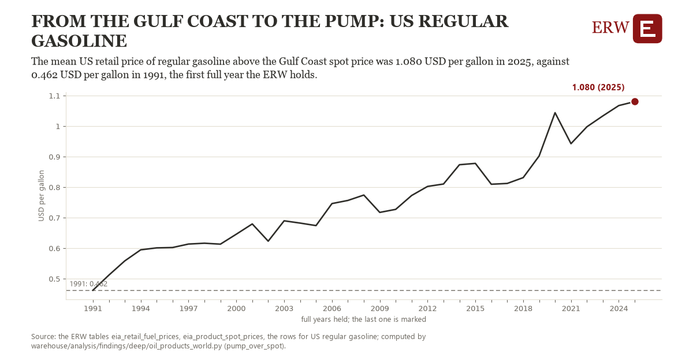

# From the gulf coast to the pump: US regular gasoline

Draft `scan-deep-4ec5d417fc01` of the findings hunt over the whole warehouse (chain 164), 2026-11-06. State: draft, not reviewed. Review at `/internal/findings`.

**The finding.** The mean US retail price of regular gasoline above the Gulf Coast spot price was 1.080 USD per gallon in 2025, against 0.462 USD per gallon in 1991, the first full year the ERW holds.

**The figure by full year** (USD per gallon): 1991: 0.462, 1992: 0.512, 1993: 0.559, 1994: 0.595, 1995: 0.601, 1996: 0.602, 1997: 0.614, 1998: 0.616, 1999: 0.613, 2000: 0.646, 2001: 0.680, 2002: 0.623, 2003: 0.690, 2004: 0.682, 2005: 0.674, 2006: 0.746, 2007: 0.757, 2008: 0.774, 2009: 0.717, 2010: 0.727, 2011: 0.773, 2012: 0.803, 2013: 0.810, 2014: 0.874, 2015: 0.878, 2016: 0.810, 2017: 0.812, 2018: 0.831, 2019: 0.902, 2020: 1.044, 2021: 0.943, 2022: 0.998, 2023: 1.034, 2024: 1.067, 2025: 1.080.

**The tables and rows.** `eia_retail_fuel_prices`, `eia_product_spot_prices`; the rows for US regular gasoline, region key `us_pump_spot` (the card's `hunt.region`), years 1991 to 2025. The yearly values: `pump-over-spot-us-pump-spot.csv`.

**Its strength.** The change is 12.59 typical yearly moves (a typical move is 0.049 USD per gallon, 1.4826 times the median absolute change between full years). Holds in more than one year: 34 of the 34 full years after 1991 lie above 1991's value. Survives a change of window: from 1992 to 2025 the change is 0.569, from 1991 to 2024 it is 0.605. Sample large enough: 1991 holds 50 and 2025 holds 52 observations; the floor is 40. Half the change remains without the first year: from 1992 to 2025 the change is 0.569, 92.0 percent of the change from 1991. At least one typical yearly move: the change is 12.59 typical yearly moves (0.049 USD per gallon a year, the median move between full years); the floor is 1.

**Its limits.** Nominal dollars; the gap holds taxes, transport, blending and the stations' margins together, and the measure does not separate them.

**Reproduce.** `python pump-over-spot-us-pump-spot.reproduce.py <the table's CSV>` and `do pump-over-spot-us-pump-spot.reproduce.do` (Stata) recompute the figures by year from the tables as the public downloads hold them; each names the expected values at its top.
