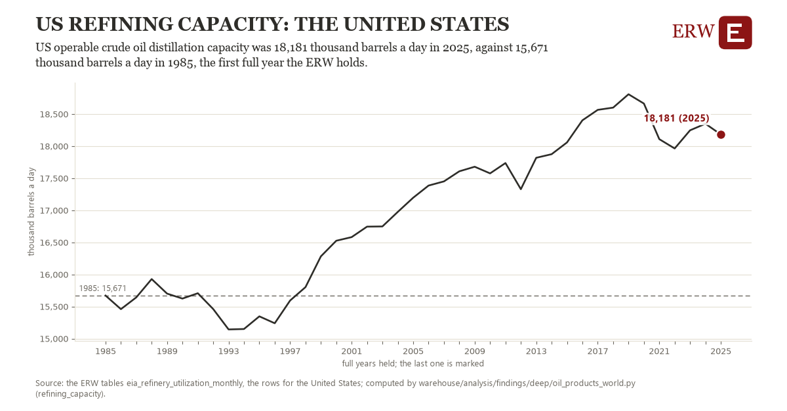

# Us refining capacity: the United States

Draft `scan-deep-5166e2ebeea5` of the findings hunt over the whole warehouse (chain 164), 2026-11-06. State: draft, not reviewed. Review at `/internal/findings`.

**The finding.** US operable crude oil distillation capacity was 18,181 thousand barrels a day in 2025, against 15,671 thousand barrels a day in 1985, the first full year the ERW holds.

**The figure by full year** (thousand barrels a day): 1985: 15,671, 1986: 15,459, 1987: 15,642, 1988: 15,928, 1989: 15,701, 1990: 15,624, 1991: 15,707, 1992: 15,460, 1993: 15,143, 1994: 15,149, 1995: 15,346, 1996: 15,239, 1997: 15,593, 1998: 15,802, 1999: 16,282, 2000: 16,525, 2001: 16,581, 2002: 16,745, 2003: 16,748, 2004: 16,974, 2005: 17,195, 2006: 17,385, 2007: 17,450, 2008: 17,607, 2009: 17,678, 2010: 17,575, 2011: 17,736, 2012: 17,328, 2013: 17,818, 2014: 17,874, 2015: 18,057, 2016: 18,402, 2017: 18,565, 2018: 18,600, 2019: 18,808, 2020: 18,663, 2021: 18,108, 2022: 17,963, 2023: 18,246, 2024: 18,348, 2025: 18,181.

**The tables and rows.** `eia_refinery_utilization_monthly`; the rows for the United States, region key `us_refining_capacity` (the card's `hunt.region`), years 1985 to 2025. The yearly values: `refining-capacity-us-refining-capacity.csv`.

**Its strength.** The change is 9.23 typical yearly moves (a typical move is 272 thousand barrels a day, 1.4826 times the median absolute change between full years). Holds in more than one year: 31 of the 40 full years after 1985 lie above 1985's value. Survives a change of window: from 1986 to 2025 the change is 2,722, from 1985 to 2024 it is 2,678. Sample large enough: 1985 holds 12 and 2025 holds 12 observations; the floor is 11. Half the change remains without the first year: from 1986 to 2025 the change is 2,722, 108.4 percent of the change from 1985. At least one typical yearly move: the change is 9.23 typical yearly moves (272 thousand barrels a day a year, the median move between full years); the floor is 1.

**Its limits.** EIA's monthly figures as published, the latest months preliminary. Operable capacity counts idle units that could run within 30 days.

**Reproduce.** `python refining-capacity-us-refining-capacity.reproduce.py <the table's CSV>` and `do refining-capacity-us-refining-capacity.reproduce.do` (Stata) recompute the figures by year from the tables as the public downloads hold them; each names the expected values at its top.
