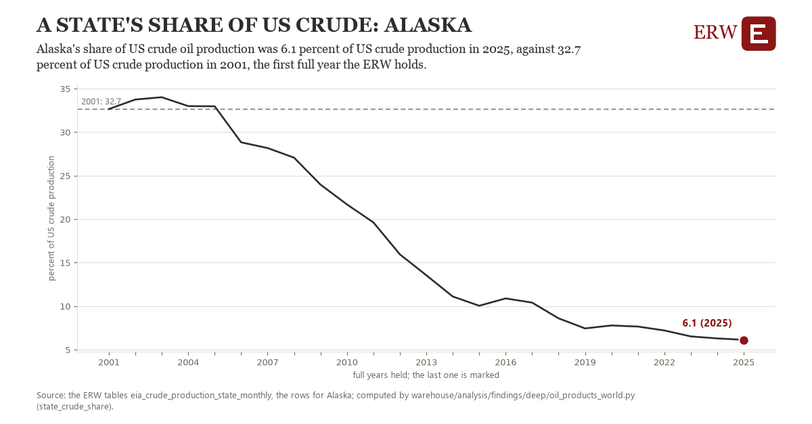

# A state's share of us crude: Alaska

Draft `scan-deep-9fa18e56c335` of the findings hunt over the whole warehouse (chain 164), 2026-11-06. State: draft, not reviewed. Review at `/internal/findings`.

**The finding.** Alaska's share of US crude oil production was 6.1 percent of US crude production in 2025, against 32.7 percent of US crude production in 2001, the first full year the ERW holds.

**The figure by full year** (percent of US crude production): 2001: 32.7, 2002: 33.7, 2003: 34.0, 2004: 33.0, 2005: 33.0, 2006: 28.8, 2007: 28.2, 2008: 27.1, 2009: 24.0, 2010: 21.7, 2011: 19.6, 2012: 16.0, 2013: 13.6, 2014: 11.1, 2015: 10.0, 2016: 10.9, 2017: 10.4, 2018: 8.6, 2019: 7.4, 2020: 7.8, 2021: 7.7, 2022: 7.2, 2023: 6.5, 2024: 6.3, 2025: 6.1.

**The tables and rows.** `eia_crude_production_state_monthly`; the rows for Alaska, region key `crude_AK` (the card's `hunt.region`), years 2001 to 2025. The yearly values: `state-crude-share-crude-ak.csv`.

**Its strength.** The change is 17.19 typical yearly moves (a typical move is 1.5 percent of US crude production, 1.4826 times the median absolute change between full years). Holds in more than one year: 20 of the 24 full years after 2001 lie below 2001's value. Survives a change of window: from 2002 to 2025 the change is -27.6, from 2001 to 2024 it is -26.4. Sample large enough: 2001 holds 24 and 2025 holds 24 observations; the floor is 11. Half the change remains without the first year: from 2002 to 2025 the change is -27.6, 104.1 percent of the change from 2001. At least one typical yearly move: the change is 17.19 typical yearly moves (1.5 percent of US crude production a year, the median move between full years); the floor is 1.

**Its limits.** EIA's field production by state, the latest months estimated; the federal offshore is in the US total and in no state.

**Reproduce.** `python state-crude-share-crude-ak.reproduce.py <the table's CSV>` and `do state-crude-share-crude-ak.reproduce.do` (Stata) recompute the figures by year from the tables as the public downloads hold them; each names the expected values at its top.
