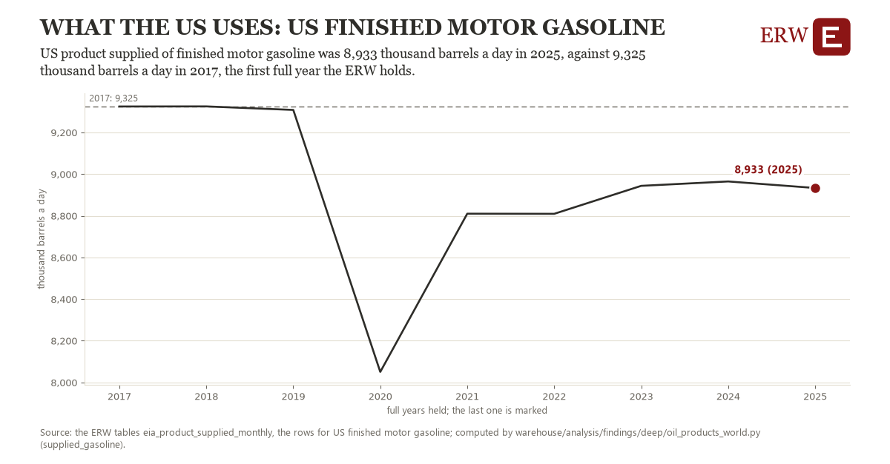

# What the us uses: US finished motor gasoline

Draft `scan-deep-201f5379da4a` of the findings hunt over the whole warehouse (chain 164), 2026-11-06. State: draft, not reviewed. Review at `/internal/findings`.

**The finding.** US product supplied of finished motor gasoline was 8,933 thousand barrels a day in 2025, against 9,325 thousand barrels a day in 2017, the first full year the ERW holds.

**The figure by full year** (thousand barrels a day): 2017: 9,325, 2018: 9,325, 2019: 9,308, 2020: 8,050, 2021: 8,810, 2022: 8,810, 2023: 8,944, 2024: 8,965, 2025: 8,933.

**The tables and rows.** `eia_product_supplied_monthly`; the rows for US finished motor gasoline, region key `us_supplied_gasoline` (the card's `hunt.region`), years 2017 to 2025. The yearly values: `supplied-gasoline-us-supplied-gasoline.csv`.

**Its strength.** The change is 10.05 typical yearly moves (a typical move is 39 thousand barrels a day, 1.4826 times the median absolute change between full years). Holds in more than one year: 7 of the 8 full years after 2017 lie below 2017's value. Survives a change of window: from 2018 to 2025 the change is -392, from 2017 to 2024 it is -360. Sample large enough: 2017 holds 12 and 2025 holds 12 observations; the floor is 11. Half the change remains without the first year: from 2018 to 2025 the change is -392, 100.1 percent of the change from 2017. At least one typical yearly move: the change is 10.05 typical yearly moves (39 thousand barrels a day a year, the median move between full years); the floor is 1.

**Its limits.** EIA's monthly figures as published, the latest months preliminary. Product supplied is EIA's measure of demand: what leaves primary supply, not what is burned that month.

**Reproduce.** `python supplied-gasoline-us-supplied-gasoline.reproduce.py <the table's CSV>` and `do supplied-gasoline-us-supplied-gasoline.reproduce.do` (Stata) recompute the figures by year from the tables as the public downloads hold them; each names the expected values at its top.
