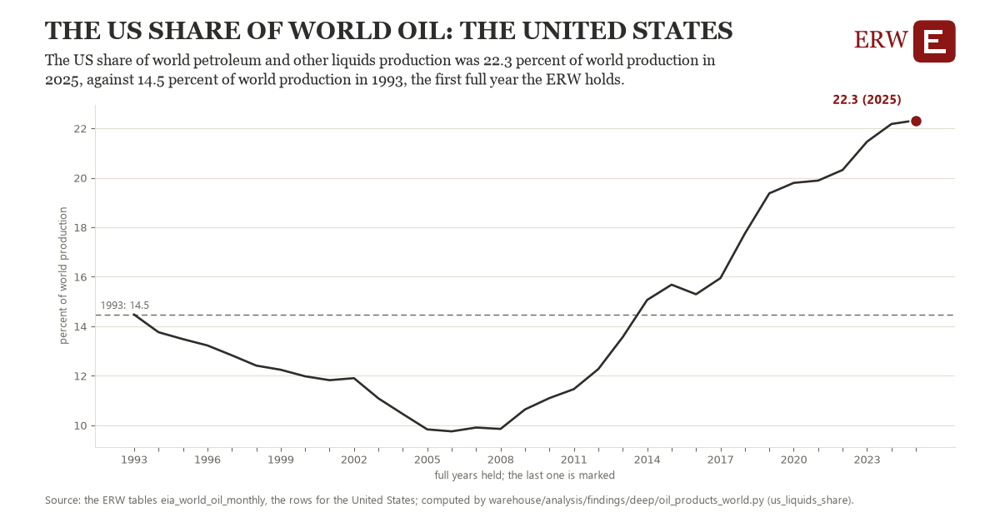

# The us share of world oil: the United States

Draft `scan-deep-3bed96cc151a` of the findings hunt over the whole warehouse (chain 164), 2026-11-06. State: draft, not reviewed. Review at `/internal/findings`.

**The finding.** The US share of world petroleum and other liquids production was 22.3 percent of world production in 2025, against 14.5 percent of world production in 1993, the first full year the ERW holds.

**The figure by full year** (percent of world production): 1993: 14.5, 1994: 13.8, 1995: 13.5, 1996: 13.2, 1997: 12.8, 1998: 12.4, 1999: 12.2, 2000: 12.0, 2001: 11.8, 2002: 11.9, 2003: 11.1, 2004: 10.5, 2005: 9.8, 2006: 9.8, 2007: 9.9, 2008: 9.9, 2009: 10.6, 2010: 11.1, 2011: 11.5, 2012: 12.3, 2013: 13.6, 2014: 15.1, 2015: 15.7, 2016: 15.3, 2017: 15.9, 2018: 17.7, 2019: 19.4, 2020: 19.8, 2021: 19.9, 2022: 20.3, 2023: 21.5, 2024: 22.2, 2025: 22.3.

**The tables and rows.** `eia_world_oil_monthly`; the rows for the United States, region key `us_world_liquids` (the card's `hunt.region`), years 1993 to 2025. The yearly values: `us-liquids-share-us-world-liquids.csv`.

**Its strength.** The change is 12.42 typical yearly moves (a typical move is 0.6 percent of world production, 1.4826 times the median absolute change between full years). Holds in more than one year: 12 of the 32 full years after 1993 lie above 1993's value. Survives a change of window: from 1994 to 2025 the change is 8.6, from 1993 to 2024 it is 7.7. Sample large enough: 1993 holds 12 and 2025 holds 12 observations; the floor is 11. Half the change remains without the first year: from 1994 to 2025 the change is 8.6, 109.1 percent of the change from 1993. At least one typical yearly move: the change is 12.42 typical yearly moves (0.6 percent of world production a year, the median move between full years); the floor is 1.

**Its limits.** EIA's monthly figures as published, the latest months preliminary. Liquids hold crude, NGPL, refinery gain and biofuels together.

**Reproduce.** `python us-liquids-share-us-world-liquids.reproduce.py <the table's CSV>` and `do us-liquids-share-us-world-liquids.reproduce.do` (Stata) recompute the figures by year from the tables as the public downloads hold them; each names the expected values at its top.
