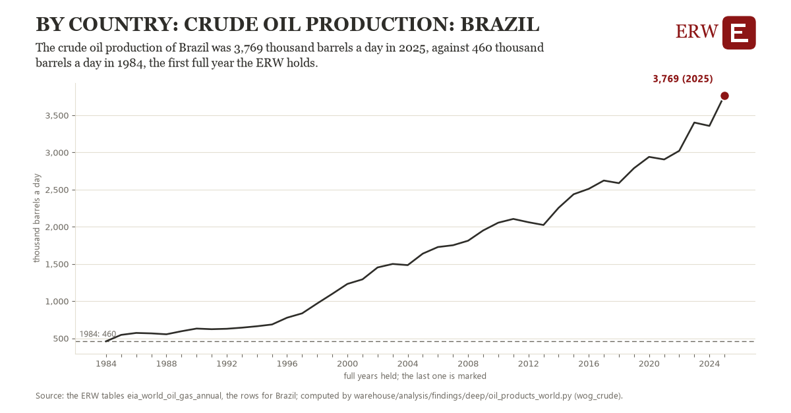

# By country: crude oil production: Brazil

Draft `scan-deep-00a941c53327` of the findings hunt over the whole warehouse (chain 502), 2026-11-19. State: draft, not reviewed. Review at `/internal/findings`.

**The finding.** The crude oil production of Brazil was 3,769 thousand barrels a day in 2025, against 460 thousand barrels a day in 1984, the first full year the ERW holds.

**The figure by full year** (thousand barrels a day): 1984: 460, 1985: 546, 1986: 572, 1987: 566, 1988: 554, 1989: 595, 1990: 631, 1991: 623, 1992: 628, 1993: 643, 1994: 662, 1995: 686, 1996: 777, 1997: 836, 1998: 969, 1999: 1,098, 2000: 1,231, 2001: 1,293, 2002: 1,453, 2003: 1,500, 2004: 1,484, 2005: 1,639, 2006: 1,727, 2007: 1,751, 2008: 1,812, 2009: 1,950, 2010: 2,055, 2011: 2,105, 2012: 2,061, 2013: 2,024, 2014: 2,255, 2015: 2,437, 2016: 2,510, 2017: 2,622, 2018: 2,587, 2019: 2,788, 2020: 2,940, 2021: 2,905, 2022: 3,022, 2023: 3,402, 2024: 3,356, 2025: 3,769.

**The tables and rows.** `eia_world_oil_gas_annual`; the rows for Brazil, region key `wog_bra` (the card's `hunt.region`), years 1984 to 2025. The yearly values: `wog-crude-wog-bra.csv`.

**Its strength.** The change is 36.76 typical yearly moves (a typical move is 90 thousand barrels a day, 1.4826 times the median absolute change between full years). Holds in more than one year: 41 of the 41 full years after 1984 lie above 1984's value. Survives a change of window: from 1985 to 2025 the change is 3,223, from 1984 to 2024 it is 2,897. Sample large enough: 1984 holds 1 and 2025 holds 1 observations; the floor is 1. Half the change remains without the first year: from 1985 to 2025 the change is 3,223, 97.4 percent of the change from 1984. At least one typical yearly move: the change is 36.76 typical yearly moves (90 thousand barrels a day a year, the median move between full years); the floor is 1.

**Its limits.** EIA's international energy data as the latest bulk file holds them; a country's recent years are often EIA's estimates; from 1980, when the series begin for every country.

**Reproduce.** `python wog-crude-wog-bra.reproduce.py <the table's CSV>` and `do wog-crude-wog-bra.reproduce.do` (Stata) recompute the figures by year from the tables as the public downloads hold them; each names the expected values at its top.
