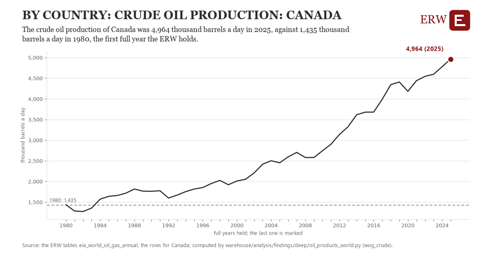

# By country: crude oil production: Canada

Draft `scan-deep-14eabd12f2fd` of the findings hunt over the whole warehouse (chain 502), 2026-11-19. State: draft, not reviewed. Review at `/internal/findings`.

**The finding.** The crude oil production of Canada was 4,964 thousand barrels a day in 2025, against 1,435 thousand barrels a day in 1980, the first full year the ERW holds.

**The figure by full year** (thousand barrels a day): 1980: 1,435, 1981: 1,285, 1982: 1,271, 1983: 1,356, 1984: 1,571, 1985: 1,639, 1986: 1,659, 1987: 1,715, 1988: 1,817, 1989: 1,765, 1990: 1,761, 1991: 1,775, 1992: 1,598, 1993: 1,669, 1994: 1,753, 1995: 1,816, 1996: 1,852, 1997: 1,949, 1998: 2,025, 1999: 1,920, 2000: 2,012, 2001: 2,052, 2002: 2,203, 2003: 2,417, 2004: 2,501, 2005: 2,452, 2006: 2,596, 2007: 2,703, 2008: 2,579, 2009: 2,579, 2010: 2,741, 2011: 2,901, 2012: 3,138, 2013: 3,325, 2014: 3,613, 2015: 3,677, 2016: 3,679, 2017: 3,990, 2018: 4,343, 2019: 4,408, 2020: 4,180, 2021: 4,439, 2022: 4,543, 2023: 4,594, 2024: 4,776, 2025: 4,964.

**The tables and rows.** `eia_world_oil_gas_annual`; the rows for Canada, region key `wog_can` (the card's `hunt.region`), years 1980 to 2025. The yearly values: `wog-crude-wog-can.csv`.

**Its strength.** The change is 24.46 typical yearly moves (a typical move is 144 thousand barrels a day, 1.4826 times the median absolute change between full years). Holds in more than one year: 42 of the 45 full years after 1980 lie above 1980's value. Survives a change of window: from 1981 to 2025 the change is 3,679, from 1980 to 2024 it is 3,341. Sample large enough: 1980 holds 1 and 2025 holds 1 observations; the floor is 1. Half the change remains without the first year: from 1981 to 2025 the change is 3,679, 104.3 percent of the change from 1980. At least one typical yearly move: the change is 24.46 typical yearly moves (144 thousand barrels a day a year, the median move between full years); the floor is 1.

**Its limits.** EIA's international energy data as the latest bulk file holds them; a country's recent years are often EIA's estimates; from 1980, when the series begin for every country.

**Reproduce.** `python wog-crude-wog-can.reproduce.py <the table's CSV>` and `do wog-crude-wog-can.reproduce.do` (Stata) recompute the figures by year from the tables as the public downloads hold them; each names the expected values at its top.
