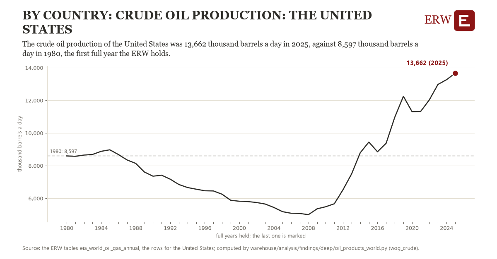

# By country: crude oil production: the United States

Draft `scan-deep-5b51761b5249` of the findings hunt over the whole warehouse (chain 502), 2026-11-19. State: draft, not reviewed. Review at `/internal/findings`.

**The finding.** The crude oil production of the United States was 13,662 thousand barrels a day in 2025, against 8,597 thousand barrels a day in 1980, the first full year the ERW holds.

**The figure by full year** (thousand barrels a day): 1980: 8,597, 1981: 8,572, 1982: 8,648, 1983: 8,688, 1984: 8,879, 1985: 8,972, 1986: 8,680, 1987: 8,349, 1988: 8,140, 1989: 7,613, 1990: 7,355, 1991: 7,417, 1992: 7,171, 1993: 6,847, 1994: 6,662, 1995: 6,560, 1996: 6,465, 1997: 6,452, 1998: 6,252, 1999: 5,881, 2000: 5,822, 2001: 5,801, 2002: 5,744, 2003: 5,649, 2004: 5,441, 2005: 5,184, 2006: 5,086, 2007: 5,074, 2008: 5,000, 2009: 5,357, 2010: 5,484, 2011: 5,667, 2012: 6,521, 2013: 7,494, 2014: 8,789, 2015: 9,446, 2016: 8,852, 2017: 9,371, 2018: 10,964, 2019: 12,248, 2020: 11,308, 2021: 11,324, 2022: 12,026, 2023: 12,972, 2024: 13,267, 2025: 13,662.

**The tables and rows.** `eia_world_oil_gas_annual`; the rows for the United States, region key `wog_usa` (the card's `hunt.region`), years 1980 to 2025. The yearly values: `wog-crude-wog-usa.csv`.

**Its strength.** The change is 16.33 typical yearly moves (a typical move is 310 thousand barrels a day, 1.4826 times the median absolute change between full years). Holds in more than one year: 17 of the 45 full years after 1980 lie above 1980's value. Survives a change of window: from 1981 to 2025 the change is 5,090, from 1980 to 2024 it is 4,670. Sample large enough: 1980 holds 1 and 2025 holds 1 observations; the floor is 1. Half the change remains without the first year: from 1981 to 2025 the change is 5,090, 100.5 percent of the change from 1980. At least one typical yearly move: the change is 16.33 typical yearly moves (310 thousand barrels a day a year, the median move between full years); the floor is 1.

**Its limits.** EIA's international energy data as the latest bulk file holds them; a country's recent years are often EIA's estimates; from 1980, when the series begin for every country.

**Reproduce.** `python wog-crude-wog-usa.reproduce.py <the table's CSV>` and `do wog-crude-wog-usa.reproduce.do` (Stata) recompute the figures by year from the tables as the public downloads hold them; each names the expected values at its top.
