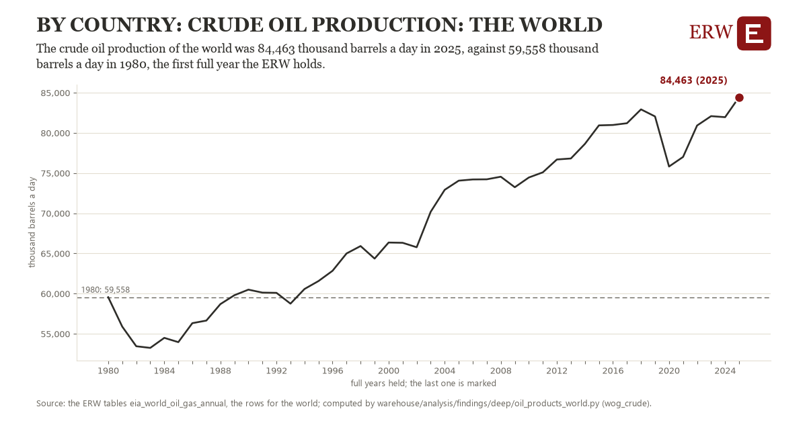

# By country: crude oil production: the world

Draft `scan-deep-107f94e3adad` of the findings hunt over the whole warehouse (chain 502), 2026-11-19. State: draft, not reviewed. Review at `/internal/findings`.

**The finding.** The crude oil production of the world was 84,463 thousand barrels a day in 2025, against 59,558 thousand barrels a day in 1980, the first full year the ERW holds.

**The figure by full year** (thousand barrels a day): 1980: 59,558, 1981: 55,900, 1982: 53,453, 1983: 53,250, 1984: 54,499, 1985: 53,965, 1986: 56,326, 1987: 56,649, 1988: 58,697, 1989: 59,803, 1990: 60,498, 1991: 60,128, 1992: 60,101, 1993: 58,754, 1994: 60,577, 1995: 61,569, 1996: 62,841, 1997: 65,001, 1998: 65,922, 1999: 64,360, 2000: 66,359, 2001: 66,327, 2002: 65,773, 2003: 70,184, 2004: 72,919, 2005: 74,057, 2006: 74,209, 2007: 74,224, 2008: 74,549, 2009: 73,241, 2010: 74,451, 2011: 75,095, 2012: 76,692, 2013: 76,817, 2014: 78,632, 2015: 80,938, 2016: 80,987, 2017: 81,205, 2018: 82,928, 2019: 82,050, 2020: 75,817, 2021: 77,009, 2022: 80,919, 2023: 82,087, 2024: 81,958, 2025: 84,463.

**The tables and rows.** `eia_world_oil_gas_annual`; the rows for the world, region key `wog_worl` (the card's `hunt.region`), years 1980 to 2025. The yearly values: `wog-crude-wog-worl.csv`.

**Its strength.** The change is 14.09 typical yearly moves (a typical move is 1,767 thousand barrels a day, 1.4826 times the median absolute change between full years). Holds in more than one year: 36 of the 45 full years after 1980 lie above 1980's value. Survives a change of window: from 1981 to 2025 the change is 28,563, from 1980 to 2024 it is 22,401. Sample large enough: 1980 holds 1 and 2025 holds 1 observations; the floor is 1. Half the change remains without the first year: from 1981 to 2025 the change is 28,563, 114.7 percent of the change from 1980. At least one typical yearly move: the change is 14.09 typical yearly moves (1,767 thousand barrels a day a year, the median move between full years); the floor is 1.

**Its limits.** EIA's international energy data as the latest bulk file holds them; a country's recent years are often EIA's estimates; from 1980, when the series begin for every country.

**Reproduce.** `python wog-crude-wog-worl.reproduce.py <the table's CSV>` and `do wog-crude-wog-worl.reproduce.do` (Stata) recompute the figures by year from the tables as the public downloads hold them; each names the expected values at its top.
