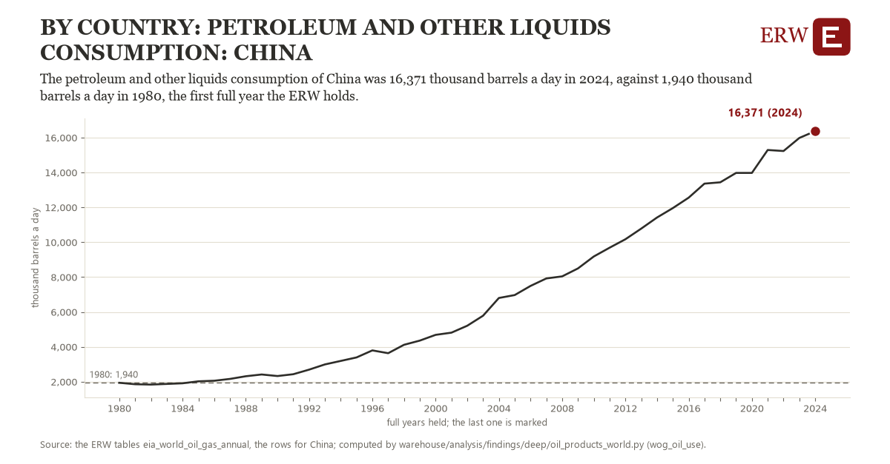

# By country: petroleum and other liquids consumption: China

Draft `scan-deep-07e8fed15fcb` of the findings hunt over the whole warehouse (chain 502), 2026-11-19. State: draft, not reviewed. Review at `/internal/findings`.

**The finding.** The petroleum and other liquids consumption of China was 16,371 thousand barrels a day in 2024, against 1,940 thousand barrels a day in 1980, the first full year the ERW holds.

**The figure by full year** (thousand barrels a day): 1980: 1,940, 1981: 1,857, 1982: 1,837, 1983: 1,874, 1984: 1,911, 1985: 2,024, 1986: 2,057, 1987: 2,162, 1988: 2,315, 1989: 2,416, 1990: 2,327, 1991: 2,431, 1992: 2,694, 1993: 2,993, 1994: 3,193, 1995: 3,394, 1996: 3,797, 1997: 3,636, 1998: 4,118, 1999: 4,359, 2000: 4,689, 2001: 4,814, 2002: 5,212, 2003: 5,786, 2004: 6,803, 2005: 6,970, 2006: 7,493, 2007: 7,923, 2008: 8,041, 2009: 8,497, 2010: 9,182, 2011: 9,686, 2012: 10,171, 2013: 10,781, 2014: 11,418, 2015: 11,958, 2016: 12,555, 2017: 13,361, 2018: 13,436, 2019: 13,975, 2020: 13,975, 2021: 15,290, 2022: 15,231, 2023: 15,981, 2024: 16,371.

**The tables and rows.** `eia_world_oil_gas_annual`; the rows for China, region key `wog_chn` (the card's `hunt.region`), years 1980 to 2024. The yearly values: `wog-oil-use-wog-chn.csv`.

**Its strength.** The change is 34.64 typical yearly moves (a typical move is 417 thousand barrels a day, 1.4826 times the median absolute change between full years). Holds in more than one year: 40 of the 44 full years after 1980 lie above 1980's value. Survives a change of window: from 1981 to 2024 the change is 14,514, from 1980 to 2023 it is 14,041. Sample large enough: 1980 holds 1 and 2024 holds 1 observations; the floor is 1. Half the change remains without the first year: from 1981 to 2024 the change is 14,514, 100.6 percent of the change from 1980. At least one typical yearly move: the change is 34.64 typical yearly moves (417 thousand barrels a day a year, the median move between full years); the floor is 1.

**Its limits.** EIA's international energy data as the latest bulk file holds them; a country's recent years are often EIA's estimates; from 1980, when the series begin for every country.

**Reproduce.** `python wog-oil-use-wog-chn.reproduce.py <the table's CSV>` and `do wog-oil-use-wog-chn.reproduce.do` (Stata) recompute the figures by year from the tables as the public downloads hold them; each names the expected values at its top.
