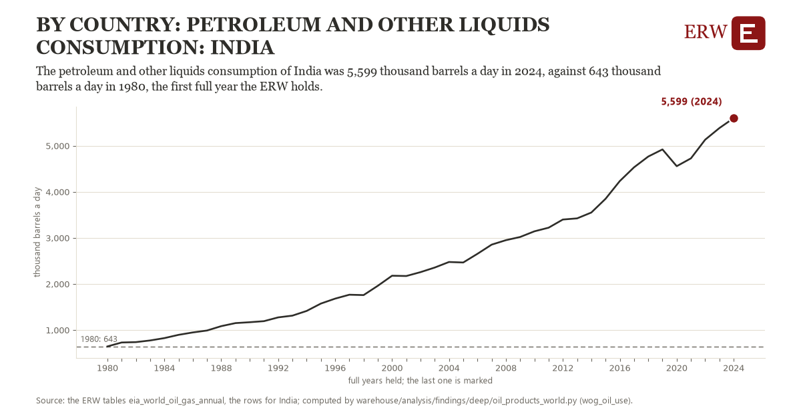

# By country: petroleum and other liquids consumption: India

Draft `scan-deep-6d69eefde4da` of the findings hunt over the whole warehouse (chain 502), 2026-11-19. State: draft, not reviewed. Review at `/internal/findings`.

**The finding.** The petroleum and other liquids consumption of India was 5,599 thousand barrels a day in 2024, against 643 thousand barrels a day in 1980, the first full year the ERW holds.

**The figure by full year** (thousand barrels a day): 1980: 643, 1981: 729, 1982: 737, 1983: 773, 1984: 824, 1985: 895, 1986: 947, 1987: 989, 1988: 1,084, 1989: 1,150, 1990: 1,169, 1991: 1,192, 1992: 1,274, 1993: 1,312, 1994: 1,414, 1995: 1,574, 1996: 1,681, 1997: 1,766, 1998: 1,758, 1999: 1,960, 2000: 2,178, 2001: 2,172, 2002: 2,256, 2003: 2,356, 2004: 2,476, 2005: 2,465, 2006: 2,654, 2007: 2,853, 2008: 2,950, 2009: 3,019, 2010: 3,142, 2011: 3,221, 2012: 3,398, 2013: 3,423, 2014: 3,550, 2015: 3,848, 2016: 4,233, 2017: 4,531, 2018: 4,765, 2019: 4,920, 2020: 4,556, 2021: 4,726, 2022: 5,131, 2023: 5,384, 2024: 5,599.

**The tables and rows.** `eia_world_oil_gas_annual`; the rows for India, region key `wog_ind` (the card's `hunt.region`), years 1980 to 2024. The yearly values: `wog-oil-use-wog-ind.csv`.

**Its strength.** The change is 34.05 typical yearly moves (a typical move is 146 thousand barrels a day, 1.4826 times the median absolute change between full years). Holds in more than one year: 44 of the 44 full years after 1980 lie above 1980's value. Survives a change of window: from 1981 to 2024 the change is 4,870, from 1980 to 2023 it is 4,741. Sample large enough: 1980 holds 1 and 2024 holds 1 observations; the floor is 1. Half the change remains without the first year: from 1981 to 2024 the change is 4,870, 98.3 percent of the change from 1980. At least one typical yearly move: the change is 34.05 typical yearly moves (146 thousand barrels a day a year, the median move between full years); the floor is 1.

**Its limits.** EIA's international energy data as the latest bulk file holds them; a country's recent years are often EIA's estimates; from 1980, when the series begin for every country.

**Reproduce.** `python wog-oil-use-wog-ind.reproduce.py <the table's CSV>` and `do wog-oil-use-wog-ind.reproduce.do` (Stata) recompute the figures by year from the tables as the public downloads hold them; each names the expected values at its top.
