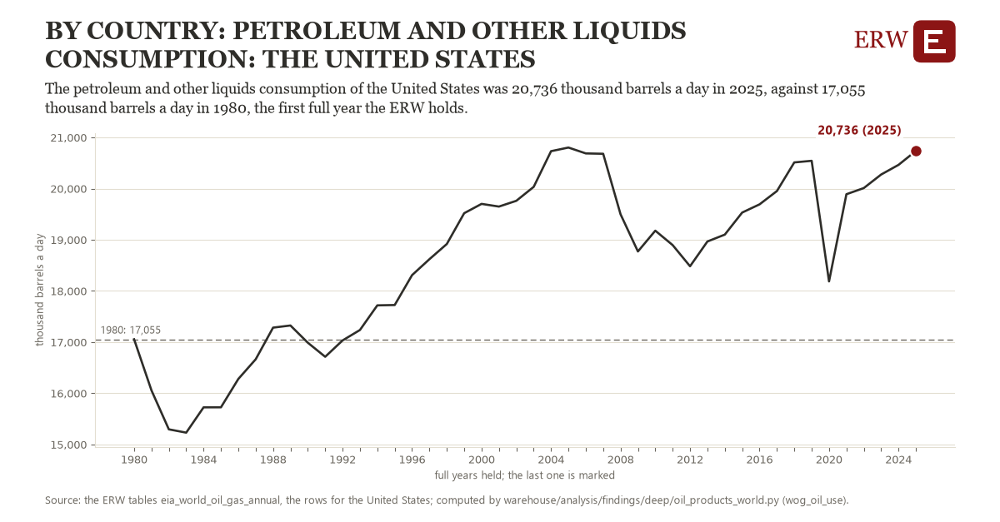

# By country: petroleum and other liquids consumption: the United States

Draft `scan-deep-3635f5b2ce66` of the findings hunt over the whole warehouse (chain 502), 2026-11-19. State: draft, not reviewed. Review at `/internal/findings`.

**The finding.** The petroleum and other liquids consumption of the United States was 20,736 thousand barrels a day in 2025, against 17,055 thousand barrels a day in 1980, the first full year the ERW holds.

**The figure by full year** (thousand barrels a day): 1980: 17,055, 1981: 16,057, 1982: 15,295, 1983: 15,231, 1984: 15,725, 1985: 15,726, 1986: 16,280, 1987: 16,664, 1988: 17,283, 1989: 17,325, 1990: 16,988, 1991: 16,713, 1992: 17,032, 1993: 17,237, 1994: 17,718, 1995: 17,725, 1996: 18,309, 1997: 18,620, 1998: 18,917, 1999: 19,519, 2000: 19,701, 2001: 19,649, 2002: 19,761, 2003: 20,034, 2004: 20,731, 2005: 20,802, 2006: 20,687, 2007: 20,680, 2008: 19,498, 2009: 18,771, 2010: 19,178, 2011: 18,896, 2012: 18,482, 2013: 18,967, 2014: 19,100, 2015: 19,532, 2016: 19,692, 2017: 19,952, 2018: 20,512, 2019: 20,543, 2020: 18,186, 2021: 19,890, 2022: 20,010, 2023: 20,275, 2024: 20,464, 2025: 20,736.

**The tables and rows.** `eia_world_oil_gas_annual`; the rows for the United States, region key `wog_usa` (the card's `hunt.region`), years 1980 to 2025. The yearly values: `wog-oil-use-wog-usa.csv`.

**Its strength.** The change is 8.36 typical yearly moves (a typical move is 440 thousand barrels a day, 1.4826 times the median absolute change between full years). Holds in more than one year: 35 of the 45 full years after 1980 lie above 1980's value. Survives a change of window: from 1981 to 2025 the change is 4,679, from 1980 to 2024 it is 3,408. Sample large enough: 1980 holds 1 and 2025 holds 1 observations; the floor is 1. Half the change remains without the first year: from 1981 to 2025 the change is 4,679, 127.1 percent of the change from 1980. At least one typical yearly move: the change is 8.36 typical yearly moves (440 thousand barrels a day a year, the median move between full years); the floor is 1.

**Its limits.** EIA's international energy data as the latest bulk file holds them; a country's recent years are often EIA's estimates; from 1980, when the series begin for every country.

**Reproduce.** `python wog-oil-use-wog-usa.reproduce.py <the table's CSV>` and `do wog-oil-use-wog-usa.reproduce.do` (Stata) recompute the figures by year from the tables as the public downloads hold them; each names the expected values at its top.
