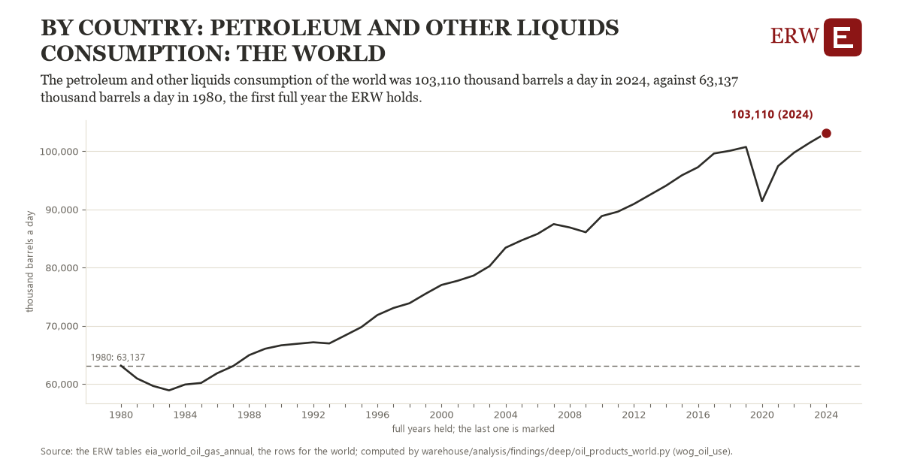

# By country: petroleum and other liquids consumption: the world

Draft `scan-deep-b38edf7114f8` of the findings hunt over the whole warehouse (chain 502), 2026-11-19. State: draft, not reviewed. Review at `/internal/findings`.

**The finding.** The petroleum and other liquids consumption of the world was 103,110 thousand barrels a day in 2024, against 63,137 thousand barrels a day in 1980, the first full year the ERW holds.

**The figure by full year** (thousand barrels a day): 1980: 63,137, 1981: 60,938, 1982: 59,654, 1983: 58,887, 1984: 59,892, 1985: 60,165, 1986: 61,829, 1987: 63,065, 1988: 64,949, 1989: 66,047, 1990: 66,635, 1991: 66,898, 1992: 67,154, 1993: 66,958, 1994: 68,350, 1995: 69,764, 1996: 71,835, 1997: 73,048, 1998: 73,866, 1999: 75,485, 2000: 77,009, 2001: 77,725, 2002: 78,613, 2003: 80,253, 2004: 83,416, 2005: 84,679, 2006: 85,795, 2007: 87,473, 2008: 86,894, 2009: 86,072, 2010: 88,850, 2011: 89,606, 2012: 90,923, 2013: 92,497, 2014: 94,059, 2015: 95,860, 2016: 97,248, 2017: 99,609, 2018: 100,080, 2019: 100,734, 2020: 91,411, 2021: 97,447, 2022: 99,757, 2023: 101,504, 2024: 103,110.

**The tables and rows.** `eia_world_oil_gas_annual`; the rows for the world, region key `wog_worl` (the card's `hunt.region`), years 1980 to 2024. The yearly values: `wog-oil-use-wog-worl.csv`.

**Its strength.** The change is 19.93 typical yearly moves (a typical move is 2,006 thousand barrels a day, 1.4826 times the median absolute change between full years). Holds in more than one year: 37 of the 44 full years after 1980 lie above 1980's value. Survives a change of window: from 1981 to 2024 the change is 42,172, from 1980 to 2023 it is 38,367. Sample large enough: 1980 holds 1 and 2024 holds 1 observations; the floor is 1. Half the change remains without the first year: from 1981 to 2024 the change is 42,172, 105.5 percent of the change from 1980. At least one typical yearly move: the change is 19.93 typical yearly moves (2,006 thousand barrels a day a year, the median move between full years); the floor is 1.

**Its limits.** EIA's international energy data as the latest bulk file holds them; a country's recent years are often EIA's estimates; from 1980, when the series begin for every country.

**Reproduce.** `python wog-oil-use-wog-worl.reproduce.py <the table's CSV>` and `do wog-oil-use-wog-worl.reproduce.do` (Stata) recompute the figures by year from the tables as the public downloads hold them; each names the expected values at its top.
