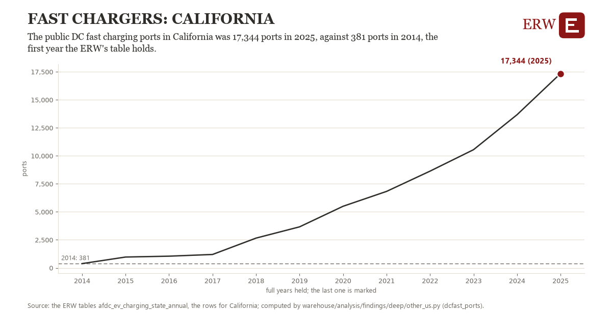

# Fast chargers: California

Draft `scan-deep-e38ab51241fa` of the findings hunt over the whole warehouse (chain 164), 2026-11-06. State: draft, not reviewed. Review at `/internal/findings`.

**The finding.** The public DC fast charging ports in California was 17,344 ports in 2025, against 381 ports in 2014, the first year the ERW's table holds.

**The figure by full year** (ports): 2014: 381, 2015: 967, 2016: 1,044, 2017: 1,196, 2018: 2,657, 2019: 3,661, 2020: 5,497, 2021: 6,824, 2022: 8,634, 2023: 10,548, 2024: 13,668, 2025: 17,344.

**The tables and rows.** `afdc_ev_charging_state_annual`; the rows for California, region key `dcfast_CA` (the card's `hunt.region`), years 2014 to 2025. The yearly values: `dcfast-ports-dcfast-ca.csv`.

**Its strength.** The change is 7.83 typical yearly moves (a typical move is 2,166 ports, 1.4826 times the median absolute change between full years). Holds in more than one year: 11 of the 11 full years after 2014 lie above 2014's value. Survives a change of window: from 2015 to 2025 the change is 16,377, from 2014 to 2024 it is 13,287. Sample large enough: 2014 holds 1 and 2025 holds 1 observations; the floor is 1. Half the change remains without the first year: from 2015 to 2025 the change is 16,377, 96.5 percent of the change from 2014. At least one typical yearly move: the change is 7.83 typical yearly moves (2,166 ports a year, the median move between full years); the floor is 1.

**Its limits.** The Alternative Fuels Data Center's historical station counts, public ports only, counted near each year's end.

**Reproduce.** `python dcfast-ports-dcfast-ca.reproduce.py <the table's CSV>` and `do dcfast-ports-dcfast-ca.reproduce.do` (Stata) recompute the figures by year from the tables as the public downloads hold them; each names the expected values at its top.
