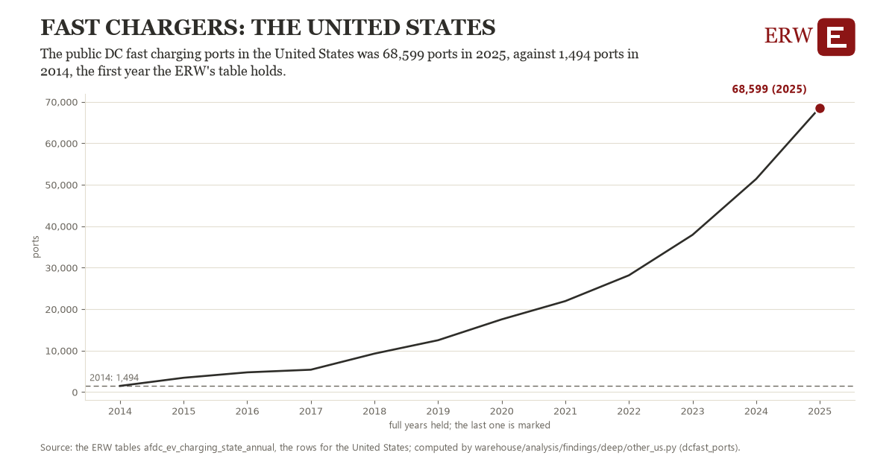

# Fast chargers: the United States

Draft `scan-deep-7f8c9d720532` of the findings hunt over the whole warehouse (chain 164), 2026-11-06. State: draft, not reviewed. Review at `/internal/findings`.

**The finding.** The public DC fast charging ports in the United States was 68,599 ports in 2025, against 1,494 ports in 2014, the first year the ERW's table holds.

**The figure by full year** (ports): 2014: 1,494, 2015: 3,456, 2016: 4,764, 2017: 5,400, 2018: 9,279, 2019: 12,511, 2020: 17,539, 2021: 21,945, 2022: 28,165, 2023: 37,920, 2024: 51,393, 2025: 68,599.

**The tables and rows.** `afdc_ev_charging_state_annual`; the rows for the United States, region key `dcfast_US` (the card's `hunt.region`), years 2014 to 2025. The yearly values: `dcfast-ports-dcfast-us.csv`.

**Its strength.** The change is 10.27 typical yearly moves (a typical move is 6,532 ports, 1.4826 times the median absolute change between full years). Holds in more than one year: 11 of the 11 full years after 2014 lie above 2014's value. Survives a change of window: from 2015 to 2025 the change is 65,143, from 2014 to 2024 it is 49,899. Sample large enough: 2014 holds 1 and 2025 holds 1 observations; the floor is 1. Half the change remains without the first year: from 2015 to 2025 the change is 65,143, 97.1 percent of the change from 2014. At least one typical yearly move: the change is 10.27 typical yearly moves (6,532 ports a year, the median move between full years); the floor is 1.

**Its limits.** The Alternative Fuels Data Center's historical station counts, public ports only, counted near each year's end.

**Reproduce.** `python dcfast-ports-dcfast-us.reproduce.py <the table's CSV>` and `do dcfast-ports-dcfast-us.reproduce.do` (Stata) recompute the figures by year from the tables as the public downloads hold them; each names the expected values at its top.
