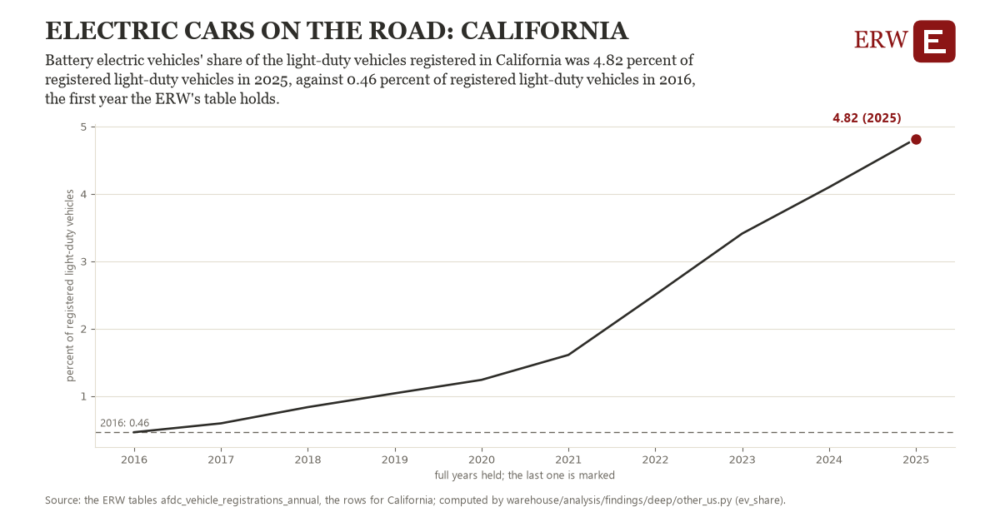

# Electric cars on the road: California

Draft `scan-deep-9996493a9202` of the findings hunt over the whole warehouse (chain 164), 2026-11-06. State: draft, not reviewed. Review at `/internal/findings`.

**The finding.** Battery electric vehicles' share of the light-duty vehicles registered in California was 4.82 percent of registered light-duty vehicles in 2025, against 0.46 percent of registered light-duty vehicles in 2016, the first year the ERW's table holds.

**The figure by full year** (percent of registered light-duty vehicles): 2016: 0.46, 2017: 0.59, 2018: 0.83, 2019: 1.04, 2020: 1.24, 2021: 1.61, 2022: 2.50, 2023: 3.41, 2024: 4.10, 2025: 4.82.

**The tables and rows.** `afdc_vehicle_registrations_annual`; the rows for California, region key `ev_CA` (the card's `hunt.region`), years 2016 to 2025. The yearly values: `ev-share-ev-ca.csv`.

**Its strength.** The change is 7.94 typical yearly moves (a typical move is 0.55 percent of registered light-duty vehicles, 1.4826 times the median absolute change between full years). Holds in more than one year: 9 of the 9 full years after 2016 lie above 2016's value. Survives a change of window: from 2017 to 2025 the change is 4.23, from 2016 to 2024 it is 3.64. Sample large enough: 2016 holds 1 and 2025 holds 1 observations; the floor is 1. Half the change remains without the first year: from 2017 to 2025 the change is 4.23, 97.0 percent of the change from 2016. At least one typical yearly move: the change is 7.94 typical yearly moves (0.55 percent of registered light-duty vehicles a year, the median move between full years); the floor is 1.

**Its limits.** The Alternative Fuels Data Center's registrations (Experian), a stock not sales; plug-in hybrids are counted apart.

**Reproduce.** `python ev-share-ev-ca.reproduce.py <the table's CSV>` and `do ev-share-ev-ca.reproduce.do` (Stata) recompute the figures by year from the tables as the public downloads hold them; each names the expected values at its top.
