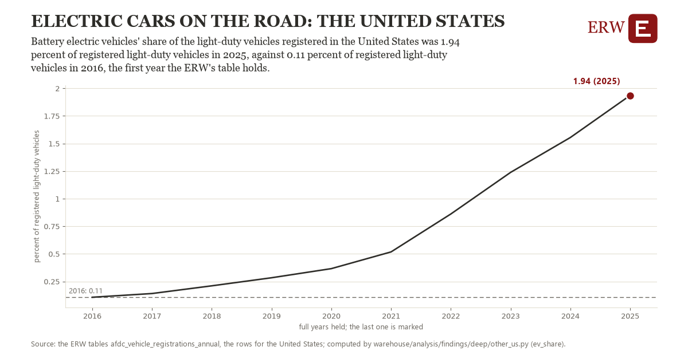

# Electric cars on the road: the United States

Draft `scan-deep-ac1de0ab330b` of the findings hunt over the whole warehouse (chain 164), 2026-11-06. State: draft, not reviewed. Review at `/internal/findings`.

**The finding.** Battery electric vehicles' share of the light-duty vehicles registered in the United States was 1.94 percent of registered light-duty vehicles in 2025, against 0.11 percent of registered light-duty vehicles in 2016, the first year the ERW's table holds.

**The figure by full year** (percent of registered light-duty vehicles): 2016: 0.11, 2017: 0.14, 2018: 0.21, 2019: 0.28, 2020: 0.37, 2021: 0.52, 2022: 0.86, 2023: 1.24, 2024: 1.55, 2025: 1.94.

**The tables and rows.** `afdc_vehicle_registrations_annual`; the rows for the United States, region key `ev_US` (the card's `hunt.region`), years 2016 to 2025. The yearly values: `ev-share-ev-us.csv`.

**Its strength.** The change is 8.14 typical yearly moves (a typical move is 0.22 percent of registered light-duty vehicles, 1.4826 times the median absolute change between full years). Holds in more than one year: 9 of the 9 full years after 2016 lie above 2016's value. Survives a change of window: from 2017 to 2025 the change is 1.80, from 2016 to 2024 it is 1.45. Sample large enough: 2016 holds 1 and 2025 holds 1 observations; the floor is 1. Half the change remains without the first year: from 2017 to 2025 the change is 1.80, 98.2 percent of the change from 2016. At least one typical yearly move: the change is 8.14 typical yearly moves (0.22 percent of registered light-duty vehicles a year, the median move between full years); the floor is 1.

**Its limits.** The Alternative Fuels Data Center's registrations (Experian), a stock not sales; plug-in hybrids are counted apart.

**Reproduce.** `python ev-share-ev-us.reproduce.py <the table's CSV>` and `do ev-share-ev-us.reproduce.do` (Stata) recompute the figures by year from the tables as the public downloads hold them; each names the expected values at its top.
