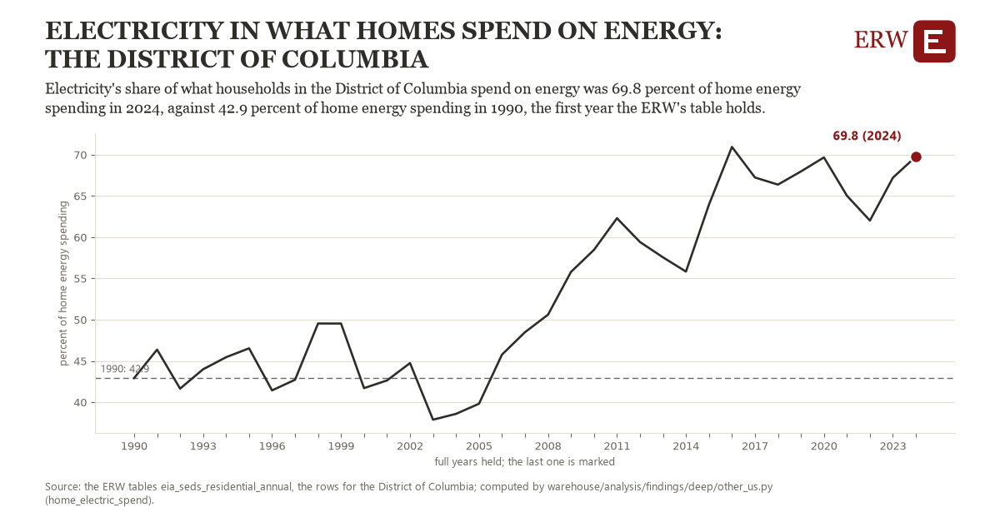

# Electricity in what homes spend on energy: the District of Columbia

Draft `scan-deep-699a4ec2bc71` of the findings hunt over the whole warehouse (chain 164), 2026-11-06. State: draft, not reviewed. Review at `/internal/findings`.

**The finding.** Electricity's share of what households in the District of Columbia spend on energy was 69.8 percent of home energy spending in 2024, against 42.9 percent of home energy spending in 1990, the first year the ERW's table holds.

**The figure by full year** (percent of home energy spending): 1990: 42.9, 1991: 46.4, 1992: 41.6, 1993: 44.0, 1994: 45.4, 1995: 46.5, 1996: 41.4, 1997: 42.7, 1998: 49.5, 1999: 49.5, 2000: 41.7, 2001: 42.6, 2002: 44.7, 2003: 37.9, 2004: 38.6, 2005: 39.8, 2006: 45.8, 2007: 48.5, 2008: 50.6, 2009: 55.8, 2010: 58.5, 2011: 62.3, 2012: 59.4, 2013: 57.6, 2014: 55.8, 2015: 63.9, 2016: 70.9, 2017: 67.2, 2018: 66.4, 2019: 68.0, 2020: 69.7, 2021: 65.0, 2022: 62.0, 2023: 67.2, 2024: 69.8.

**The tables and rows.** `eia_seds_residential_annual`; the rows for the District of Columbia, region key `home_elec_DC` (the card's `hunt.region`), years 1990 to 2024. The yearly values: `home-electric-spend-home-elec-dc.csv`.

**Its strength.** The change is 6.72 typical yearly moves (a typical move is 4.0 percent of home energy spending, 1.4826 times the median absolute change between full years). Holds in more than one year: 26 of the 34 full years after 1990 lie above 1990's value. Survives a change of window: from 1991 to 2024 the change is 23.4, from 1990 to 2023 it is 24.3. Sample large enough: 1990 holds 1 and 2024 holds 1 observations; the floor is 1. Half the change remains without the first year: from 1991 to 2024 the change is 23.4, 87.2 percent of the change from 1990. At least one typical yearly move: the change is 6.72 typical yearly moves (4.0 percent of home energy spending a year, the median move between full years); the floor is 1.

**Its limits.** EIA's State Energy Data System, nominal dollars; a share of spending moves with prices as much as with use.

**Reproduce.** `python home-electric-spend-home-elec-dc.reproduce.py <the table's CSV>` and `do home-electric-spend-home-elec-dc.reproduce.do` (Stata) recompute the figures by year from the tables as the public downloads hold them; each names the expected values at its top.
