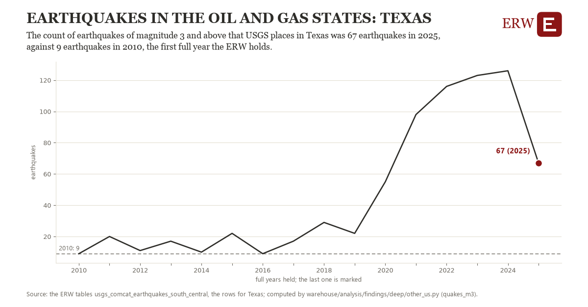

# Earthquakes in the oil and gas states: Texas

Draft `scan-deep-74e4f078b15b` of the findings hunt over the whole warehouse (chain 502), 2026-11-19. State: draft, not reviewed. Review at `/internal/findings`.

**The finding.** The count of earthquakes of magnitude 3 and above that USGS places in Texas was 67 earthquakes in 2025, against 9 earthquakes in 2010, the first full year the ERW holds.

**The figure by full year** (earthquakes): 2010: 9, 2011: 20, 2012: 11, 2013: 17, 2014: 10, 2015: 22, 2016: 9, 2017: 17, 2018: 29, 2019: 22, 2020: 55, 2021: 98, 2022: 116, 2023: 123, 2024: 126, 2025: 67.

**The tables and rows.** `usgs_comcat_earthquakes_south_central`; the rows for Texas, region key `eq_texas` (the card's `hunt.region`), years 2010 to 2025. The yearly values: `quakes-m3-eq-texas.csv`.

**Its strength.** The change is 3.56 typical yearly moves (a typical move is 16 earthquakes, 1.4826 times the median absolute change between full years). Holds in more than one year: 14 of the 15 full years after 2010 lie above 2010's value. Survives a change of window: from 2011 to 2025 the change is 47, from 2010 to 2024 it is 117. Sample large enough: 2010 holds 1 and 2025 holds 1 observations; the floor is 1. Half the change remains without the first year: from 2011 to 2025 the change is 47, 81.0 percent of the change from 2010. At least one typical yearly move: the change is 3.56 typical yearly moves (16 earthquakes a year, the median move between full years); the floor is 1.

**Its limits.** USGS's ComCat as of 23 October 2026, magnitude 2.5 and above in the box of Oklahoma, Kansas, Texas and New Mexico, by the state the catalog's place names; a count, not a cause.

**Reproduce.** `python quakes-m3-eq-texas.reproduce.py <the table's CSV>` and `do quakes-m3-eq-texas.reproduce.do` (Stata) recompute the figures by year from the tables as the public downloads hold them; each names the expected values at its top.
