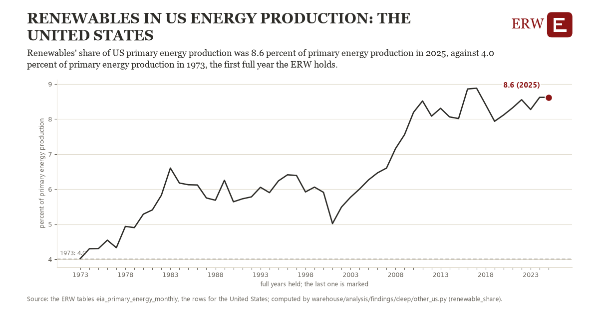

# Renewables in us energy production: the United States

Draft `scan-deep-03ee2f7ee6fd` of the findings hunt over the whole warehouse (chain 164), 2026-11-06. State: draft, not reviewed. Review at `/internal/findings`.

**The finding.** Renewables' share of US primary energy production was 8.6 percent of primary energy production in 2025, against 4.0 percent of primary energy production in 1973, the first full year the ERW holds.

**The figure by full year** (percent of primary energy production): 1973: 4.0, 1974: 4.3, 1975: 4.3, 1976: 4.5, 1977: 4.3, 1978: 4.9, 1979: 4.9, 1980: 5.3, 1981: 5.4, 1982: 5.8, 1983: 6.6, 1984: 6.2, 1985: 6.1, 1986: 6.1, 1987: 5.7, 1988: 5.7, 1989: 6.3, 1990: 5.6, 1991: 5.7, 1992: 5.8, 1993: 6.1, 1994: 5.9, 1995: 6.2, 1996: 6.4, 1997: 6.4, 1998: 5.9, 1999: 6.1, 2000: 5.9, 2001: 5.0, 2002: 5.5, 2003: 5.8, 2004: 6.0, 2005: 6.3, 2006: 6.5, 2007: 6.6, 2008: 7.2, 2009: 7.6, 2010: 8.2, 2011: 8.5, 2012: 8.1, 2013: 8.3, 2014: 8.1, 2015: 8.0, 2016: 8.9, 2017: 8.9, 2018: 8.4, 2019: 7.9, 2020: 8.1, 2021: 8.3, 2022: 8.6, 2023: 8.3, 2024: 8.6, 2025: 8.6.

**The tables and rows.** `eia_primary_energy_monthly`; the rows for the United States, region key `us_renewable_share` (the card's `hunt.region`), years 1973 to 2025. The yearly values: `renewable-share-us-renewable-share.csv`.

**Its strength.** The change is 12.23 typical yearly moves (a typical move is 0.4 percent of primary energy production, 1.4826 times the median absolute change between full years). Holds in more than one year: 52 of the 52 full years after 1973 lie above 1973's value. Survives a change of window: from 1974 to 2025 the change is 4.3, from 1973 to 2024 it is 4.6. Sample large enough: 1973 holds 12 and 2025 holds 12 observations; the floor is 11. Half the change remains without the first year: from 1974 to 2025 the change is 4.3, 93.9 percent of the change from 1973. At least one typical yearly move: the change is 12.23 typical yearly moves (0.4 percent of primary energy production a year, the median move between full years); the floor is 1.

**Its limits.** EIA's Monthly Energy Review, primary energy in Btu; renewables count hydro, wind, solar, wood, waste, geothermal and biofuels together.

**Reproduce.** `python renewable-share-us-renewable-share.reproduce.py <the table's CSV>` and `do renewable-share-us-renewable-share.reproduce.do` (Stata) recompute the figures by year from the tables as the public downloads hold them; each names the expected values at its top.
