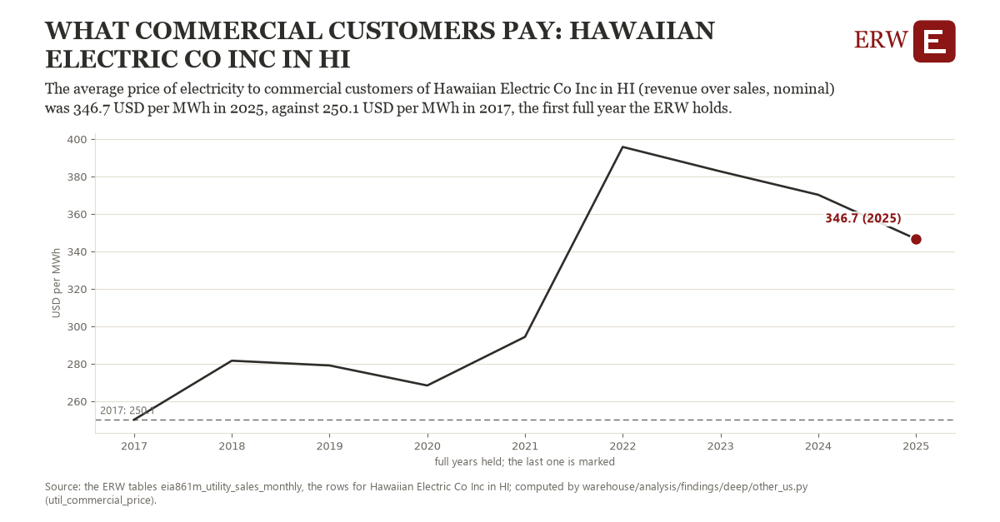

# What commercial customers pay: Hawaiian Electric Co Inc in HI

Draft `scan-deep-279bdd41bc18` of the findings hunt over the whole warehouse (chain 502), 2026-11-19. State: draft, not reviewed. Review at `/internal/findings`.

**The finding.** The average price of electricity to commercial customers of Hawaiian Electric Co Inc in HI (revenue over sales, nominal) was 346.7 USD per MWh in 2025, against 250.1 USD per MWh in 2017, the first full year the ERW holds.

**The figure by full year** (USD per MWh): 2017: 250.1, 2018: 281.6, 2019: 279.1, 2020: 268.4, 2021: 294.4, 2022: 395.8, 2023: 382.7, 2024: 370.3, 2025: 346.7.

**The tables and rows.** `eia861m_utility_sales_monthly`; the rows for Hawaiian Electric Co Inc in HI, region key `u861_19547_hi` (the card's `hunt.region`), years 2017 to 2025. The yearly values: `util-commercial-price-u861-19547-hi.csv`.

**Its strength.** The change is 3.55 typical yearly moves (a typical move is 27.2 USD per MWh, 1.4826 times the median absolute change between full years). Holds in more than one year: 8 of the 8 full years after 2017 lie above 2017's value. Survives a change of window: from 2018 to 2025 the change is 65.0, from 2017 to 2024 it is 120.1. Sample large enough: 2017 holds 12 and 2025 holds 12 observations; the floor is 12. Half the change remains without the first year: from 2018 to 2025 the change is 65.0, 67.4 percent of the change from 2017. At least one typical yearly move: the change is 3.55 typical yearly moves (27.2 USD per MWh a year, the median move between full years); the floor is 1.

**Its limits.** EIA Form 861M as the utility filed it, in one state, its sales to the customers it serves; states with retail or community choice are not read; a utility that merged or changed its EIA number starts again under its new number; the latest year's months may be preliminary. Nominal dollars.

**Reproduce.** `python util-commercial-price-u861-19547-hi.reproduce.py <the table's CSV>` and `do util-commercial-price-u861-19547-hi.reproduce.do` (Stata) recompute the figures by year from the tables as the public downloads hold them; each names the expected values at its top.
