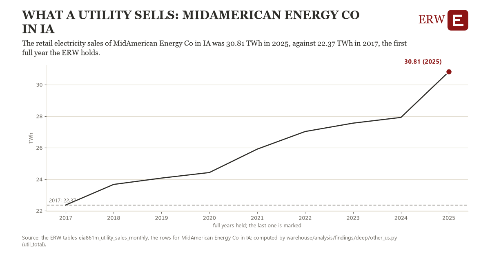

# What a utility sells: MidAmerican Energy Co in IA

Draft `scan-deep-9aac7342018d` of the findings hunt over the whole warehouse (chain 502), 2026-11-19. State: draft, not reviewed. Review at `/internal/findings`.

**The finding.** The retail electricity sales of MidAmerican Energy Co in IA was 30.81 TWh in 2025, against 22.37 TWh in 2017, the first full year the ERW holds.

**The figure by full year** (TWh): 2017: 22.37, 2018: 23.67, 2019: 24.07, 2020: 24.42, 2021: 25.91, 2022: 27.02, 2023: 27.55, 2024: 27.92, 2025: 30.81.

**The tables and rows.** `eia861m_utility_sales_monthly`; the rows for MidAmerican Energy Co in IA, region key `u861_12341_ia` (the card's `hunt.region`), years 2017 to 2025. The yearly values: `util-total-u861-12341-ia.csv`.

**Its strength.** The change is 6.92 typical yearly moves (a typical move is 1.22 TWh, 1.4826 times the median absolute change between full years). Holds in more than one year: 8 of the 8 full years after 2017 lie above 2017's value. Survives a change of window: from 2018 to 2025 the change is 7.14, from 2017 to 2024 it is 5.55. Sample large enough: 2017 holds 12 and 2025 holds 12 observations; the floor is 12. Half the change remains without the first year: from 2018 to 2025 the change is 7.14, 84.6 percent of the change from 2017. At least one typical yearly move: the change is 6.92 typical yearly moves (1.22 TWh a year, the median move between full years); the floor is 1.

**Its limits.** EIA Form 861M as the utility filed it, in one state, its sales to the customers it serves; states with retail or community choice are not read; a utility that merged or changed its EIA number starts again under its new number; the latest year's months may be preliminary.

**Reproduce.** `python util-total-u861-12341-ia.reproduce.py <the table's CSV>` and `do util-total-u861-12341-ia.reproduce.do` (Stata) recompute the figures by year from the tables as the public downloads hold them; each names the expected values at its top.
