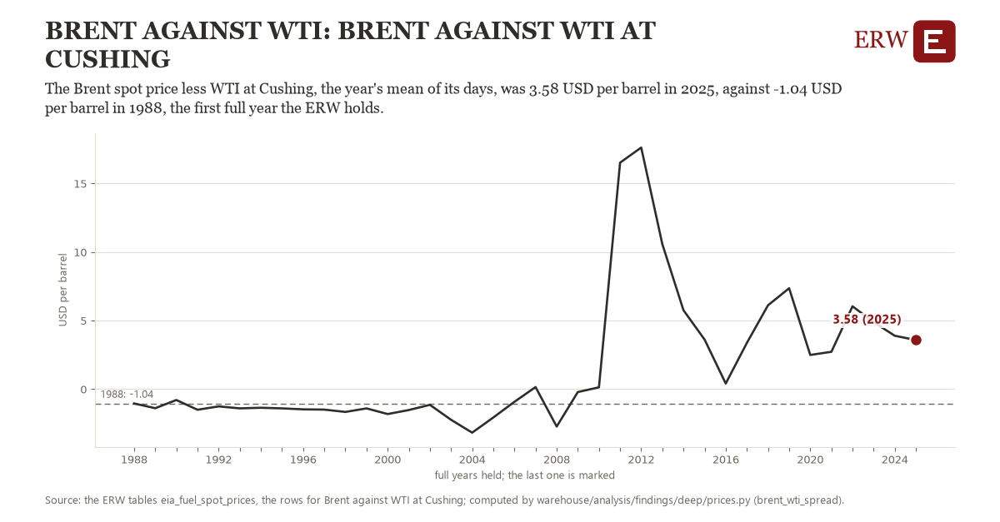

# Brent against wti: Brent against WTI at Cushing

Draft `scan-deep-602c1f95afe4` of the findings hunt over the whole warehouse (chain 164), 2026-11-06. State: draft, not reviewed. Review at `/internal/findings`.

**The finding.** The Brent spot price less WTI at Cushing, the year's mean of its days, was 3.58 USD per barrel in 2025, against -1.04 USD per barrel in 1988, the first full year the ERW holds.

**The figure by full year** (USD per barrel): 1988: -1.04, 1989: -1.39, 1990: -0.79, 1991: -1.50, 1992: -1.26, 1993: -1.40, 1994: -1.36, 1995: -1.40, 1996: -1.47, 1997: -1.49, 1998: -1.66, 1999: -1.40, 2000: -1.82, 2001: -1.52, 2002: -1.14, 2003: -2.23, 2004: -3.17, 2005: -2.07, 2006: -0.92, 2007: 0.15, 2008: -2.73, 2009: -0.21, 2010: 0.13, 2011: 16.52, 2012: 17.62, 2013: 10.57, 2014: 5.76, 2015: 3.62, 2016: 0.41, 2017: 3.37, 2018: 6.12, 2019: 7.36, 2020: 2.49, 2021: 2.72, 2022: 6.04, 2023: 4.89, 2024: 3.90, 2025: 3.58.

**The tables and rows.** `eia_fuel_spot_prices`; the rows for Brent against WTI at Cushing, region key `us_brent_wti` (the card's `hunt.region`), years 1988 to 2025. The yearly values: `brent-wti-spread-us-brent-wti.csv`.

**Its strength.** The change is 3.15 typical yearly moves (a typical move is 1.47 USD per barrel, 1.4826 times the median absolute change between full years). Holds in more than one year: 20 of the 37 full years after 1988 lie above 1988's value. Survives a change of window: from 1989 to 2025 the change is 4.97, from 1988 to 2024 it is 4.94. Sample large enough: 1988 holds 254 and 2025 holds 244 observations; the floor is 200. Half the change remains without the first year: from 1989 to 2025 the change is 4.97, 107.5 percent of the change from 1988. At least one typical yearly move: the change is 3.15 typical yearly moves (1.47 USD per barrel a year, the median move between full years); the floor is 1.

**Its limits.** Nominal dollars; the two are spot closes at different places and qualities, and the spread includes the cost of moving crude between them.

**Reproduce.** `python brent-wti-spread-us-brent-wti.reproduce.py <the table's CSV>` and `do brent-wti-spread-us-brent-wti.reproduce.do` (Stata) recompute the figures by year from the tables as the public downloads hold them; each names the expected values at its top.
