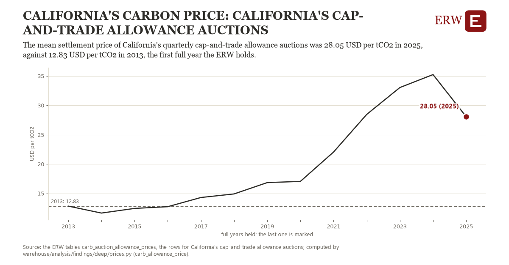

# California's carbon price: California's cap-and-trade allowance auctions

Draft `scan-deep-5671faf8f993` of the findings hunt over the whole warehouse (chain 164), 2026-11-06. State: draft, not reviewed. Review at `/internal/findings`.

**The finding.** The mean settlement price of California's quarterly cap-and-trade allowance auctions was 28.05 USD per tCO2 in 2025, against 12.83 USD per tCO2 in 2013, the first full year the ERW holds.

**The figure by full year** (USD per tCO2): 2013: 12.83, 2014: 11.65, 2015: 12.44, 2016: 12.73, 2017: 14.30, 2018: 14.91, 2019: 16.84, 2020: 17.04, 2021: 22.04, 2022: 28.45, 2023: 33.03, 2024: 35.23, 2025: 28.05.

**The tables and rows.** `carb_auction_allowance_prices`; the rows for California's cap-and-trade allowance auctions, region key `us_ca_allowance` (the card's `hunt.region`), years 2013 to 2025. The yearly values: `carb-allowance-price-us-ca-allowance.csv`.

**Its strength.** The change is 5.88 typical yearly moves (a typical move is 2.59 USD per tCO2, 1.4826 times the median absolute change between full years). Holds in more than one year: 9 of the 12 full years after 2013 lie above 2013's value. Survives a change of window: from 2014 to 2025 the change is 16.41, from 2013 to 2024 it is 22.40. Sample large enough: 2013 holds 4 and 2025 holds 4 observations; the floor is 4. Half the change remains without the first year: from 2014 to 2025 the change is 16.41, 107.8 percent of the change from 2013. At least one typical yearly move: the change is 5.88 typical yearly moves (2.59 USD per tCO2 a year, the median move between full years); the floor is 1.

**Its limits.** Four auctions a year in nominal dollars; the auction floor price rises each year by rule, and the measure does not separate the floor from the market.

**Reproduce.** `python carb-allowance-price-us-ca-allowance.reproduce.py <the table's CSV>` and `do carb-allowance-price-us-ca-allowance.reproduce.do` (Stata) recompute the figures by year from the tables as the public downloads hold them; each names the expected values at its top.
