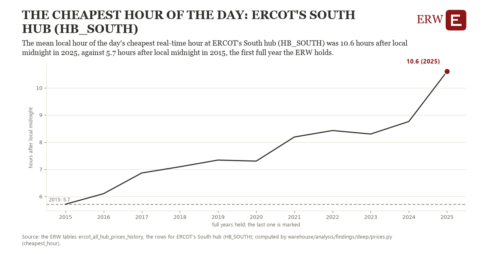

# The cheapest hour of the day: ERCOT's South hub (HB_SOUTH)

Draft `scan-deep-2575e2a95070` of the findings hunt over the whole warehouse (chain 164), 2026-11-06. State: draft, not reviewed. Review at `/internal/findings`.

**The finding.** The mean local hour of the day's cheapest real-time hour at ERCOT's South hub (HB_SOUTH) was 10.6 hours after local midnight in 2025, against 5.7 hours after local midnight in 2015, the first full year the ERW holds.

**The figure by full year** (hours after local midnight): 2015: 5.7, 2016: 6.1, 2017: 6.9, 2018: 7.1, 2019: 7.3, 2020: 7.3, 2021: 8.2, 2022: 8.4, 2023: 8.3, 2024: 8.8, 2025: 10.6.

**The tables and rows.** `ercot_all_hub_prices_history`; the rows for ERCOT's South hub (HB_SOUTH), region key `ercot_HB_SOUTH` (the card's `hunt.region`), years 2015 to 2025. The yearly values: `cheapest-hour-ercot-hb-south.csv`.

**Its strength.** The change is 10.38 typical yearly moves (a typical move is 0.5 hours after local midnight, 1.4826 times the median absolute change between full years). Holds in more than one year: 10 of the 10 full years after 2015 lie above 2015's value. Survives a change of window: from 2016 to 2025 the change is 4.5, from 2015 to 2024 it is 3.0. Sample large enough: 2015 holds 365 and 2025 holds 365 observations; the floor is 330. Half the change remains without the first year: from 2016 to 2025 the change is 4.5, 92.1 percent of the change from 2015. At least one typical yearly move: the change is 10.38 typical yearly moves (0.5 hours after local midnight a year, the median move between full years); the floor is 1.

**Its limits.** A mean of clock hours: a year with cheap hours split between night and midday averages to an hour in between that may itself be rarely the cheapest.

**Reproduce.** `python cheapest-hour-ercot-hb-south.reproduce.py <the table's CSV>` and `do cheapest-hour-ercot-hb-south.reproduce.do` (Stata) recompute the figures by year from the tables as the public downloads hold them; each names the expected values at its top.
