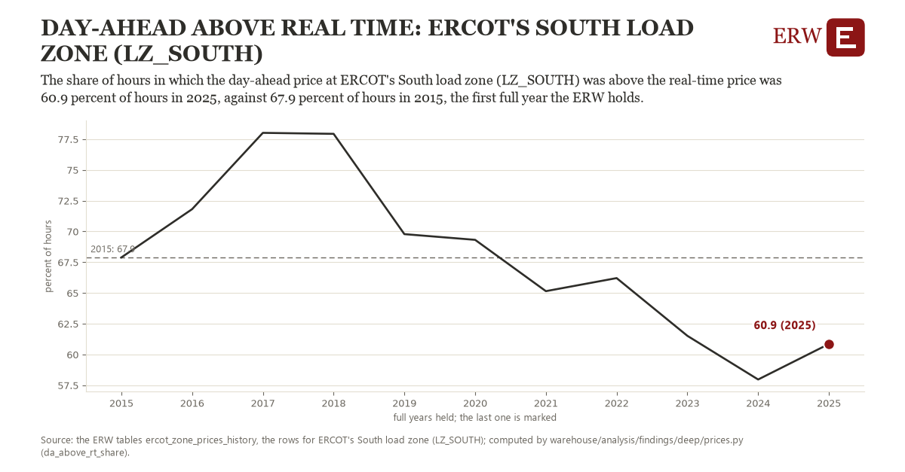

# Day-ahead above real time: ERCOT's South load zone (LZ_SOUTH)

Draft `scan-deep-8144236bc4fd` of the findings hunt over the whole warehouse (chain 164), 2026-11-06. State: draft, not reviewed. Review at `/internal/findings`.

**The finding.** The share of hours in which the day-ahead price at ERCOT's South load zone (LZ_SOUTH) was above the real-time price was 60.9 percent of hours in 2025, against 67.9 percent of hours in 2015, the first full year the ERW holds.

**The figure by full year** (percent of hours): 2015: 67.9, 2016: 71.8, 2017: 78.0, 2018: 77.9, 2019: 69.8, 2020: 69.3, 2021: 65.1, 2022: 66.2, 2023: 61.5, 2024: 58.0, 2025: 60.9.

**The tables and rows.** `ercot_zone_prices_history`; the rows for ERCOT's South load zone (LZ_SOUTH), region key `ercot_LZ_SOUTH` (the card's `hunt.region`), years 2015 to 2025. The yearly values: `da-above-rt-share-ercot-lz-south.csv`.

**Its strength.** The change is 1.27 typical yearly moves (a typical move is 5.5 percent of hours, 1.4826 times the median absolute change between full years). Holds in more than one year: 5 of the 10 full years after 2015 lie below 2015's value. Survives a change of window: from 2016 to 2025 the change is -11.0, from 2015 to 2024 it is -9.9. Sample large enough: 2015 holds 8,760 and 2025 holds 8,760 observations; the floor is 8,000. Half the change remains without the first year: from 2016 to 2025 the change is -11.0, 155.8 percent of the change from 2015. At least one typical yearly move: the change is 1.27 typical yearly moves (5.5 percent of hours a year, the median move between full years); the floor is 1.

**Its limits.** A count of hours, not of dollars: it says how often the day-ahead price was the higher, not by how much.

**Reproduce.** `python da-above-rt-share-ercot-lz-south.reproduce.py <the table's CSV>` and `do da-above-rt-share-ercot-lz-south.reproduce.do` (Stata) recompute the figures by year from the tables as the public downloads hold them; each names the expected values at its top.
