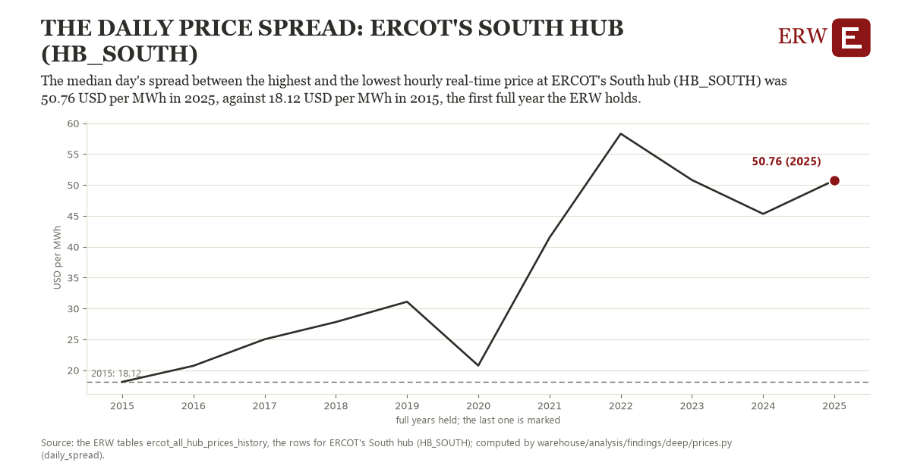

# The daily price spread: ERCOT's South hub (HB_SOUTH)

Draft `scan-deep-de3c20a9ed97` of the findings hunt over the whole warehouse (chain 164), 2026-11-06. State: draft, not reviewed. Review at `/internal/findings`.

**The finding.** The median day's spread between the highest and the lowest hourly real-time price at ERCOT's South hub (HB_SOUTH) was 50.76 USD per MWh in 2025, against 18.12 USD per MWh in 2015, the first full year the ERW holds.

**The figure by full year** (USD per MWh): 2015: 18.12, 2016: 20.73, 2017: 25.02, 2018: 27.82, 2019: 31.10, 2020: 20.77, 2021: 41.48, 2022: 58.30, 2023: 50.80, 2024: 45.32, 2025: 50.76.

**The tables and rows.** `ercot_all_hub_prices_history`; the rows for ERCOT's South hub (HB_SOUTH), region key `ercot_HB_SOUTH` (the card's `hunt.region`), years 2015 to 2025. The yearly values: `daily-spread-ercot-hb-south.csv`.

**Its strength.** The change is 4.03 typical yearly moves (a typical move is 8.09 USD per MWh, 1.4826 times the median absolute change between full years). Holds in more than one year: 10 of the 10 full years after 2015 lie above 2015's value. Survives a change of window: from 2016 to 2025 the change is 30.03, from 2015 to 2024 it is 27.20. Sample large enough: 2015 holds 365 and 2025 holds 365 observations; the floor is 330. Half the change remains without the first year: from 2016 to 2025 the change is 30.03, 92.0 percent of the change from 2015. At least one typical yearly move: the change is 4.03 typical yearly moves (8.09 USD per MWh a year, the median move between full years); the floor is 1.

**Its limits.** Nominal dollars, not adjusted for inflation; a spread a battery could capture only in part (it charges and discharges over hours, not one hour each).

**Reproduce.** `python daily-spread-ercot-hb-south.reproduce.py <the table's CSV>` and `do daily-spread-ercot-hb-south.reproduce.do` (Stata) recompute the figures by year from the tables as the public downloads hold them; each names the expected values at its top.
