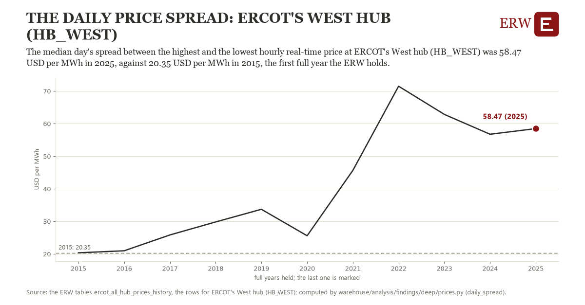

# The daily price spread: ERCOT's West hub (HB_WEST)

Draft `scan-deep-a2e22707d072` of the findings hunt over the whole warehouse (chain 164), 2026-11-06. State: draft, not reviewed. Review at `/internal/findings`.

**The finding.** The median day's spread between the highest and the lowest hourly real-time price at ERCOT's West hub (HB_WEST) was 58.47 USD per MWh in 2025, against 20.35 USD per MWh in 2015, the first full year the ERW holds.

**The figure by full year** (USD per MWh): 2015: 20.35, 2016: 20.96, 2017: 25.83, 2018: 29.81, 2019: 33.70, 2020: 25.58, 2021: 45.65, 2022: 71.49, 2023: 62.84, 2024: 56.74, 2025: 58.47.

**The tables and rows.** `ercot_all_hub_prices_history`; the rows for ERCOT's West hub (HB_WEST), region key `ercot_HB_WEST` (the card's `hunt.region`), years 2015 to 2025. The yearly values: `daily-spread-ercot-hb-west.csv`.

**Its strength.** The change is 4.69 typical yearly moves (a typical move is 8.12 USD per MWh, 1.4826 times the median absolute change between full years). Holds in more than one year: 10 of the 10 full years after 2015 lie above 2015's value. Survives a change of window: from 2016 to 2025 the change is 37.50, from 2015 to 2024 it is 36.39. Sample large enough: 2015 holds 365 and 2025 holds 365 observations; the floor is 330. Half the change remains without the first year: from 2016 to 2025 the change is 37.50, 98.4 percent of the change from 2015. At least one typical yearly move: the change is 4.69 typical yearly moves (8.12 USD per MWh a year, the median move between full years); the floor is 1.

**Its limits.** Nominal dollars, not adjusted for inflation; a spread a battery could capture only in part (it charges and discharges over hours, not one hour each).

**Reproduce.** `python daily-spread-ercot-hb-west.reproduce.py <the table's CSV>` and `do daily-spread-ercot-hb-west.reproduce.do` (Stata) recompute the figures by year from the tables as the public downloads hold them; each names the expected values at its top.
