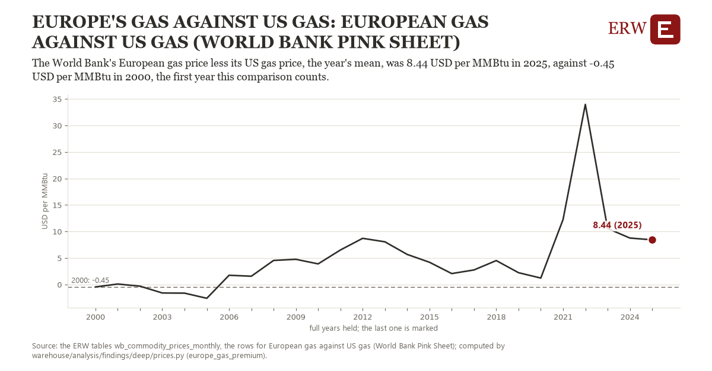

# Europe's gas against us gas: European gas against US gas (World Bank Pink Sheet)

Draft `scan-deep-f01a569678ac` of the findings hunt over the whole warehouse (chain 164), 2026-11-06. State: draft, not reviewed. Review at `/internal/findings`.

**The finding.** The World Bank's European gas price less its US gas price, the year's mean, was 8.44 USD per MMBtu in 2025, against -0.45 USD per MMBtu in 2000, the first year this comparison counts.

**The figure by full year** (USD per MMBtu): 2000: -0.45, 2001: 0.10, 2002: -0.30, 2003: -1.59, 2004: -1.62, 2005: -2.59, 2006: 1.75, 2007: 1.57, 2008: 4.55, 2009: 4.76, 2010: 3.90, 2011: 6.52, 2012: 8.72, 2013: 8.06, 2014: 5.68, 2015: 4.21, 2016: 2.07, 2017: 2.76, 2018: 4.52, 2019: 2.24, 2020: 1.23, 2021: 12.27, 2022: 33.97, 2023: 10.58, 2024: 8.77, 2025: 8.44.

**The tables and rows.** `wb_commodity_prices_monthly`; the rows for European gas against US gas (World Bank Pink Sheet), region key `us_europe_gas` (the card's `hunt.region`), years 2000 to 2025. The yearly values: `europe-gas-premium-us-europe-gas.csv`.

**Its strength.** The change is 4.06 typical yearly moves (a typical move is 2.19 USD per MMBtu, 1.4826 times the median absolute change between full years). Holds in more than one year: 22 of the 25 full years after 2000 lie above 2000's value. Survives a change of window: from 2001 to 2025 the change is 8.33, from 2000 to 2024 it is 9.22. Sample large enough: 2000 holds 12 and 2025 holds 12 observations; the floor is 12. Half the change remains without the first year: from 2001 to 2025 the change is 8.33, 93.8 percent of the change from 2000. At least one typical yearly move: the change is 4.06 typical yearly moves (2.19 USD per MMBtu a year, the median move between full years); the floor is 1.

**Its limits.** Monthly index prices in nominal dollars; the Europe index is the World Bank's, not a price any US exporter received.

**Reproduce.** `python europe-gas-premium-us-europe-gas.reproduce.py <the table's CSV>` and `do europe-gas-premium-us-europe-gas.reproduce.do` (Stata) recompute the figures by year from the tables as the public downloads hold them; each names the expected values at its top.
