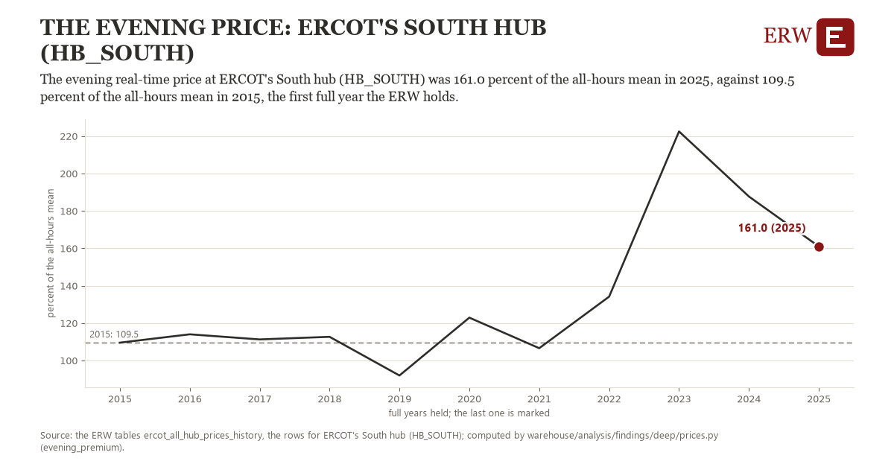

# The evening price: ERCOT's South hub (HB_SOUTH)

Draft `scan-deep-0ff3c59ac283` of the findings hunt over the whole warehouse (chain 164), 2026-11-06. State: draft, not reviewed. Review at `/internal/findings`.

**The finding.** The evening real-time price at ERCOT's South hub (HB_SOUTH) was 161.0 percent of the all-hours mean in 2025, against 109.5 percent of the all-hours mean in 2015, the first full year the ERW holds.

**The figure by full year** (percent of the all-hours mean): 2015: 109.5, 2016: 114.0, 2017: 111.3, 2018: 112.7, 2019: 92.0, 2020: 122.9, 2021: 106.6, 2022: 134.2, 2023: 222.5, 2024: 187.7, 2025: 161.0.

**The tables and rows.** `ercot_all_hub_prices_history`; the rows for ERCOT's South hub (HB_SOUTH), region key `ercot_HB_SOUTH` (the card's `hunt.region`), years 2015 to 2025. The yearly values: `evening-premium-ercot-hb-south.csv`.

**Its strength.** The change is 1.46 typical yearly moves (a typical move is 35.1 percent of the all-hours mean, 1.4826 times the median absolute change between full years). Holds in more than one year: 8 of the 10 full years after 2015 lie above 2015's value. Survives a change of window: from 2016 to 2025 the change is 47.0, from 2015 to 2024 it is 78.2. Sample large enough: 2015 holds 8,760 and 2025 holds 8,760 observations; the floor is 8,000. Half the change remains without the first year: from 2016 to 2025 the change is 47.0, 91.3 percent of the change from 2015. At least one typical yearly move: the change is 1.46 typical yearly moves (35.1 percent of the all-hours mean a year, the median move between full years); the floor is 1.

**Its limits.** A ratio of two means: a few evening scarcity hours can carry most of a year's premium, and the measure does not say how many.

**Reproduce.** `python evening-premium-ercot-hb-south.reproduce.py <the table's CSV>` and `do evening-premium-ercot-hb-south.reproduce.do` (Stata) recompute the figures by year from the tables as the public downloads hold them; each names the expected values at its top.
