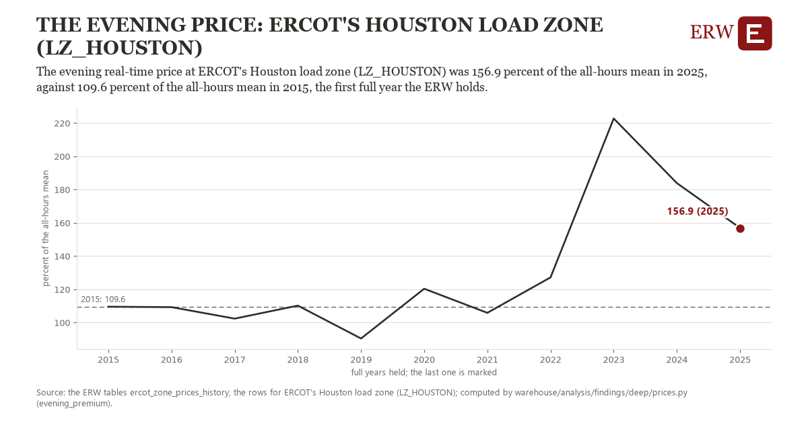

# The evening price: ERCOT's Houston load zone (LZ_HOUSTON)

Draft `scan-deep-83ca4deea096` of the findings hunt over the whole warehouse (chain 164), 2026-11-06. State: draft, not reviewed. Review at `/internal/findings`.

**The finding.** The evening real-time price at ERCOT's Houston load zone (LZ_HOUSTON) was 156.9 percent of the all-hours mean in 2025, against 109.6 percent of the all-hours mean in 2015, the first full year the ERW holds.

**The figure by full year** (percent of the all-hours mean): 2015: 109.6, 2016: 109.3, 2017: 102.4, 2018: 110.2, 2019: 90.4, 2020: 120.4, 2021: 105.9, 2022: 127.2, 2023: 222.8, 2024: 183.9, 2025: 156.9.

**The tables and rows.** `ercot_zone_prices_history`; the rows for ERCOT's Houston load zone (LZ_HOUSTON), region key `ercot_LZ_HOUSTON` (the card's `hunt.region`), years 2015 to 2025. The yearly values: `evening-premium-ercot-lz-houston.csv`.

**Its strength.** The change is 1.55 typical yearly moves (a typical move is 30.5 percent of the all-hours mean, 1.4826 times the median absolute change between full years). Holds in more than one year: 6 of the 10 full years after 2015 lie above 2015's value. Survives a change of window: from 2016 to 2025 the change is 47.6, from 2015 to 2024 it is 74.3. Sample large enough: 2015 holds 8,760 and 2025 holds 8,760 observations; the floor is 8,000. Half the change remains without the first year: from 2016 to 2025 the change is 47.6, 100.5 percent of the change from 2015. At least one typical yearly move: the change is 1.55 typical yearly moves (30.5 percent of the all-hours mean a year, the median move between full years); the floor is 1.

**Its limits.** A ratio of two means: a few evening scarcity hours can carry most of a year's premium, and the measure does not say how many.

**Reproduce.** `python evening-premium-ercot-lz-houston.reproduce.py <the table's CSV>` and `do evening-premium-ercot-lz-houston.reproduce.do` (Stata) recompute the figures by year from the tables as the public downloads hold them; each names the expected values at its top.
