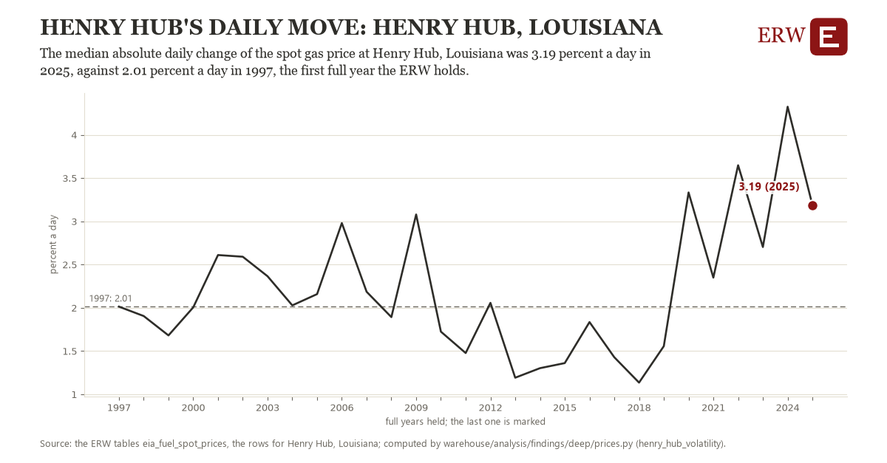

# Henry hub's daily move: Henry Hub, Louisiana

Draft `scan-deep-0226feeb5cde` of the findings hunt over the whole warehouse (chain 164), 2026-11-06. State: draft, not reviewed. Review at `/internal/findings`.

**The finding.** The median absolute daily change of the spot gas price at Henry Hub, Louisiana was 3.19 percent a day in 2025, against 2.01 percent a day in 1997, the first full year the ERW holds.

**The figure by full year** (percent a day): 1997: 2.01, 1998: 1.90, 1999: 1.68, 2000: 2.01, 2001: 2.61, 2002: 2.59, 2003: 2.36, 2004: 2.03, 2005: 2.16, 2006: 2.98, 2007: 2.19, 2008: 1.89, 2009: 3.08, 2010: 1.72, 2011: 1.48, 2012: 2.06, 2013: 1.19, 2014: 1.30, 2015: 1.36, 2016: 1.83, 2017: 1.43, 2018: 1.14, 2019: 1.56, 2020: 3.33, 2021: 2.35, 2022: 3.65, 2023: 2.70, 2024: 4.32, 2025: 3.19.

**The tables and rows.** `eia_fuel_spot_prices`; the rows for Henry Hub, Louisiana, region key `us_henry_hub` (the card's `hunt.region`), years 1997 to 2025. The yearly values: `henry-hub-volatility-us-henry-hub.csv`.

**Its strength.** The change is 1.77 typical yearly moves (a typical move is 0.66 percent a day, 1.4826 times the median absolute change between full years). Holds in more than one year: 15 of the 28 full years after 1997 lie above 1997's value. Survives a change of window: from 1998 to 2025 the change is 1.28, from 1997 to 2024 it is 2.31. Sample large enough: 1997 holds 248 and 2025 holds 247 observations; the floor is 200. Half the change remains without the first year: from 1998 to 2025 the change is 1.28, 109.2 percent of the change from 1997. At least one typical yearly move: the change is 1.77 typical yearly moves (0.66 percent a day a year, the median move between full years); the floor is 1.

**Its limits.** Trading days as EIA publishes them; a change across a weekend or a holiday counts as one day's.

**Reproduce.** `python henry-hub-volatility-us-henry-hub.reproduce.py <the table's CSV>` and `do henry-hub-volatility-us-henry-hub.reproduce.do` (Stata) recompute the figures by year from the tables as the public downloads hold them; each names the expected values at its top.
