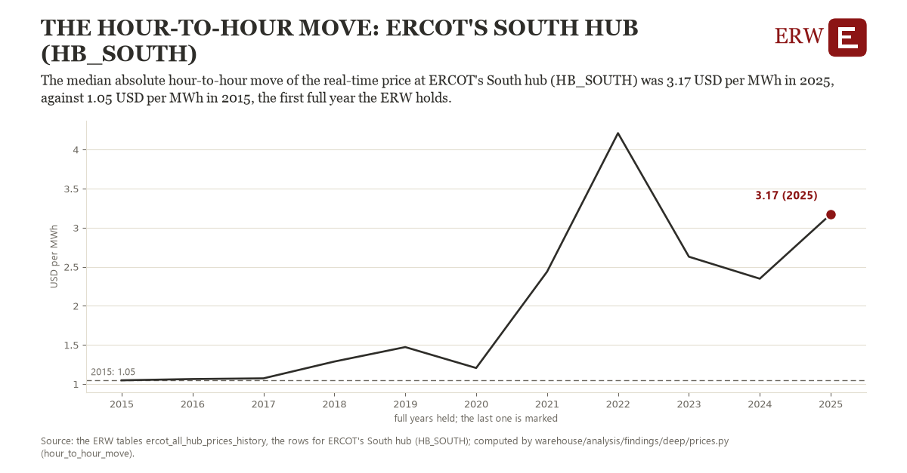

# The hour-to-hour move: ERCOT's South hub (HB_SOUTH)

Draft `scan-deep-e814d43a8641` of the findings hunt over the whole warehouse (chain 164), 2026-11-06. State: draft, not reviewed. Review at `/internal/findings`.

**The finding.** The median absolute hour-to-hour move of the real-time price at ERCOT's South hub (HB_SOUTH) was 3.17 USD per MWh in 2025, against 1.05 USD per MWh in 2015, the first full year the ERW holds.

**The figure by full year** (USD per MWh): 2015: 1.05, 2016: 1.06, 2017: 1.07, 2018: 1.29, 2019: 1.47, 2020: 1.21, 2021: 2.44, 2022: 4.21, 2023: 2.63, 2024: 2.35, 2025: 3.17.

**The tables and rows.** `ercot_all_hub_prices_history`; the rows for ERCOT's South hub (HB_SOUTH), region key `ercot_HB_SOUTH` (the card's `hunt.region`), years 2015 to 2025. The yearly values: `hour-to-hour-move-ercot-hb-south.csv`.

**Its strength.** The change is 5.22 typical yearly moves (a typical move is 0.41 USD per MWh, 1.4826 times the median absolute change between full years). Holds in more than one year: 10 of the 10 full years after 2015 lie above 2015's value. Survives a change of window: from 2016 to 2025 the change is 2.11, from 2015 to 2024 it is 1.30. Sample large enough: 2015 holds 8,759 and 2025 holds 8,760 observations; the floor is 8,000. Half the change remains without the first year: from 2016 to 2025 the change is 2.11, 99.2 percent of the change from 2015. At least one typical yearly move: the change is 5.22 typical yearly moves (0.41 USD per MWh a year, the median move between full years); the floor is 1.

**Its limits.** A median of hourly moves in nominal dollars; it says how the typical hour moves, not how the rare spike does.

**Reproduce.** `python hour-to-hour-move-ercot-hb-south.reproduce.py <the table's CSV>` and `do hour-to-hour-move-ercot-hb-south.reproduce.do` (Stata) recompute the figures by year from the tables as the public downloads hold them; each names the expected values at its top.
