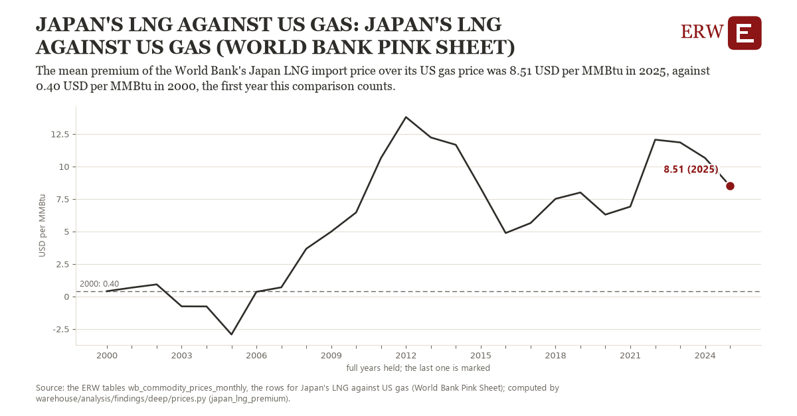

# Japan's lng against us gas: Japan's LNG against US gas (World Bank Pink Sheet)

Draft `scan-deep-d6e2173a680c` of the findings hunt over the whole warehouse (chain 164), 2026-11-06. State: draft, not reviewed. Review at `/internal/findings`.

**The finding.** The mean premium of the World Bank's Japan LNG import price over its US gas price was 8.51 USD per MMBtu in 2025, against 0.40 USD per MMBtu in 2000, the first year this comparison counts.

**The figure by full year** (USD per MMBtu): 2000: 0.40, 2001: 0.68, 2002: 0.93, 2003: -0.76, 2004: -0.77, 2005: -2.93, 2006: 0.36, 2007: 0.70, 2008: 3.67, 2009: 4.99, 2010: 6.46, 2011: 10.66, 2012: 13.80, 2013: 12.23, 2014: 11.67, 2015: 8.32, 2016: 4.88, 2017: 5.65, 2018: 7.51, 2019: 8.00, 2020: 6.30, 2021: 6.91, 2022: 12.06, 2023: 11.85, 2024: 10.65, 2025: 8.51.

**The tables and rows.** `wb_commodity_prices_monthly`; the rows for Japan's LNG against US gas (World Bank Pink Sheet), region key `us_japan_lng` (the card's `hunt.region`), years 2000 to 2025. The yearly values: `japan-lng-premium-us-japan-lng.csv`.

**Its strength.** The change is 3.48 typical yearly moves (a typical move is 2.33 USD per MMBtu, 1.4826 times the median absolute change between full years). Holds in more than one year: 21 of the 25 full years after 2000 lie above 2000's value. Survives a change of window: from 2001 to 2025 the change is 7.83, from 2000 to 2024 it is 10.25. Sample large enough: 2000 holds 12 and 2025 holds 12 observations; the floor is 12. Half the change remains without the first year: from 2001 to 2025 the change is 7.83, 96.6 percent of the change from 2000. At least one typical yearly move: the change is 3.48 typical yearly moves (2.33 USD per MMBtu a year, the median move between full years); the floor is 1.

**Its limits.** Monthly prices in nominal dollars; Japan's is a delivered import price, the US one a hub price, so the gap includes shipping and liquefaction.

**Reproduce.** `python japan-lng-premium-us-japan-lng.reproduce.py <the table's CSV>` and `do japan-lng-premium-us-japan-lng.reproduce.do` (Stata) recompute the figures by year from the tables as the public downloads hold them; each names the expected values at its top.
