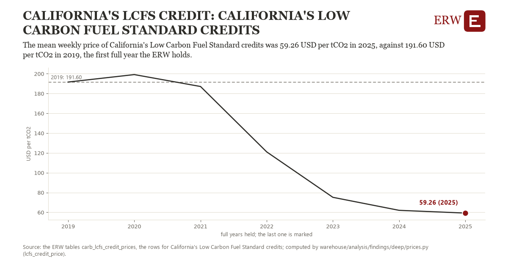

# California's lcfs credit: California's Low Carbon Fuel Standard credits

Draft `scan-deep-5f1311606943` of the findings hunt over the whole warehouse (chain 164), 2026-11-06. State: draft, not reviewed. Review at `/internal/findings`.

**The finding.** The mean weekly price of California's Low Carbon Fuel Standard credits was 59.26 USD per tCO2 in 2025, against 191.60 USD per tCO2 in 2019, the first full year the ERW holds.

**The figure by full year** (USD per tCO2): 2019: 191.60, 2020: 199.14, 2021: 187.11, 2022: 121.05, 2023: 75.16, 2024: 62.02, 2025: 59.26.

**The tables and rows.** `carb_lcfs_credit_prices`; the rows for California's Low Carbon Fuel Standard credits, region key `us_ca_lcfs` (the card's `hunt.region`), years 2019 to 2025. The yearly values: `lcfs-credit-price-us-ca-lcfs.csv`.

**Its strength.** The change is 7.10 typical yearly moves (a typical move is 18.65 USD per tCO2, 1.4826 times the median absolute change between full years). Holds in more than one year: 5 of the 6 full years after 2019 lie below 2019's value. Survives a change of window: from 2020 to 2025 the change is -139.88, from 2019 to 2024 it is -129.58. Sample large enough: 2019 holds 52 and 2025 holds 52 observations; the floor is 40. Half the change remains without the first year: from 2020 to 2025 the change is -139.88, 105.7 percent of the change from 2019. At least one typical yearly move: the change is 7.10 typical yearly moves (18.65 USD per tCO2 a year, the median move between full years); the floor is 1.

**Its limits.** Weekly averages of reported credit transfers in nominal dollars; a mean of weeks, not weighted by the credits each week moved.

**Reproduce.** `python lcfs-credit-price-us-ca-lcfs.reproduce.py <the table's CSV>` and `do lcfs-credit-price-us-ca-lcfs.reproduce.do` (Stata) recompute the figures by year from the tables as the public downloads hold them; each names the expected values at its top.
