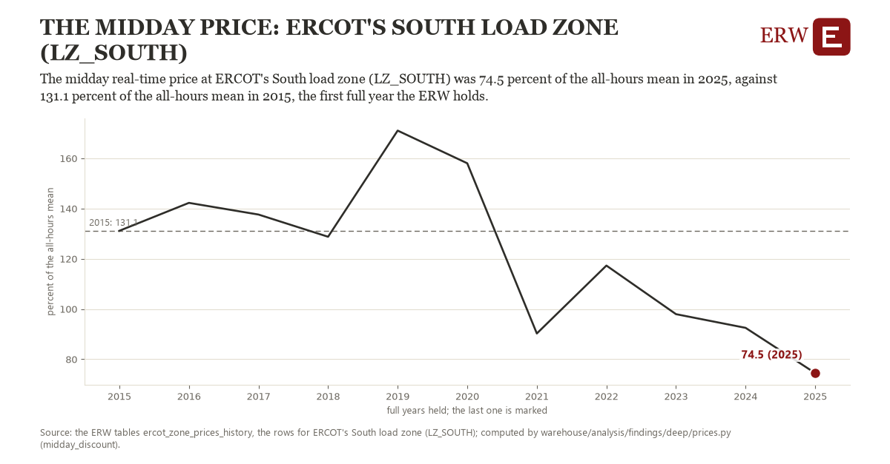

# The midday price: ERCOT's South load zone (LZ_SOUTH)

Draft `scan-deep-3da968045e4d` of the findings hunt over the whole warehouse (chain 164), 2026-11-06. State: draft, not reviewed. Review at `/internal/findings`.

**The finding.** The midday real-time price at ERCOT's South load zone (LZ_SOUTH) was 74.5 percent of the all-hours mean in 2025, against 131.1 percent of the all-hours mean in 2015, the first full year the ERW holds.

**The figure by full year** (percent of the all-hours mean): 2015: 131.1, 2016: 142.2, 2017: 137.6, 2018: 128.8, 2019: 171.0, 2020: 158.0, 2021: 90.2, 2022: 117.3, 2023: 97.9, 2024: 92.5, 2025: 74.5.

**The tables and rows.** `ercot_zone_prices_history`; the rows for ERCOT's South load zone (LZ_SOUTH), region key `ercot_LZ_SOUTH` (the card's `hunt.region`), years 2015 to 2025. The yearly values: `midday-discount-ercot-lz-south.csv`.

**Its strength.** The change is 2.46 typical yearly moves (a typical move is 23.0 percent of the all-hours mean, 1.4826 times the median absolute change between full years). Holds in more than one year: 6 of the 10 full years after 2015 lie below 2015's value. Survives a change of window: from 2016 to 2025 the change is -67.8, from 2015 to 2024 it is -38.6. Sample large enough: 2015 holds 8,760 and 2025 holds 8,760 observations; the floor is 8,000. Half the change remains without the first year: from 2016 to 2025 the change is -67.8, 119.6 percent of the change from 2015. At least one typical yearly move: the change is 2.46 typical yearly moves (23.0 percent of the all-hours mean a year, the median move between full years); the floor is 1.

**Its limits.** A ratio of two means: a year whose all-hours mean is lifted by a few scarcity hours shows a lower midday percent without any change at midday.

**Reproduce.** `python midday-discount-ercot-lz-south.reproduce.py <the table's CSV>` and `do midday-discount-ercot-lz-south.reproduce.do` (Stata) recompute the figures by year from the tables as the public downloads hold them; each names the expected values at its top.
