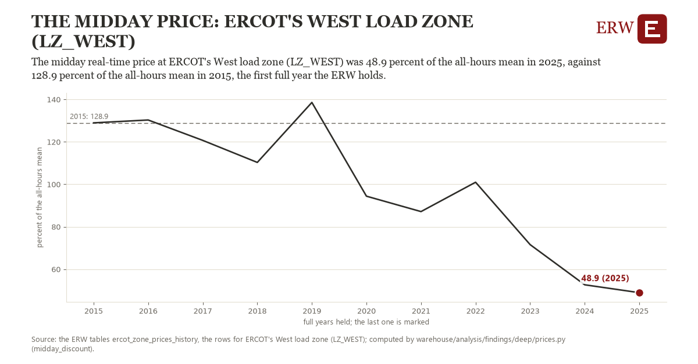

# The midday price: ERCOT's West load zone (LZ_WEST)

Draft `scan-deep-ec2251cf2ae7` of the findings hunt over the whole warehouse (chain 164), 2026-11-06. State: draft, not reviewed. Review at `/internal/findings`.

**The finding.** The midday real-time price at ERCOT's West load zone (LZ_WEST) was 48.9 percent of the all-hours mean in 2025, against 128.9 percent of the all-hours mean in 2015, the first full year the ERW holds.

**The figure by full year** (percent of the all-hours mean): 2015: 128.9, 2016: 130.3, 2017: 120.7, 2018: 110.3, 2019: 138.6, 2020: 94.4, 2021: 87.1, 2022: 101.0, 2023: 71.6, 2024: 52.6, 2025: 48.9.

**The tables and rows.** `ercot_zone_prices_history`; the rows for ERCOT's West load zone (LZ_WEST), region key `ercot_LZ_WEST` (the card's `hunt.region`), years 2015 to 2025. The yearly values: `midday-discount-ercot-lz-west.csv`.

**Its strength.** The change is 4.46 typical yearly moves (a typical move is 18.0 percent of the all-hours mean, 1.4826 times the median absolute change between full years). Holds in more than one year: 8 of the 10 full years after 2015 lie below 2015's value. Survives a change of window: from 2016 to 2025 the change is -81.4, from 2015 to 2024 it is -76.3. Sample large enough: 2015 holds 8,760 and 2025 holds 8,760 observations; the floor is 8,000. Half the change remains without the first year: from 2016 to 2025 the change is -81.4, 101.7 percent of the change from 2015. At least one typical yearly move: the change is 4.46 typical yearly moves (18.0 percent of the all-hours mean a year, the median move between full years); the floor is 1.

**Its limits.** A ratio of two means: a year whose all-hours mean is lifted by a few scarcity hours shows a lower midday percent without any change at midday.

**Reproduce.** `python midday-discount-ercot-lz-west.reproduce.py <the table's CSV>` and `do midday-discount-ercot-lz-west.reproduce.do` (Stata) recompute the figures by year from the tables as the public downloads hold them; each names the expected values at its top.
