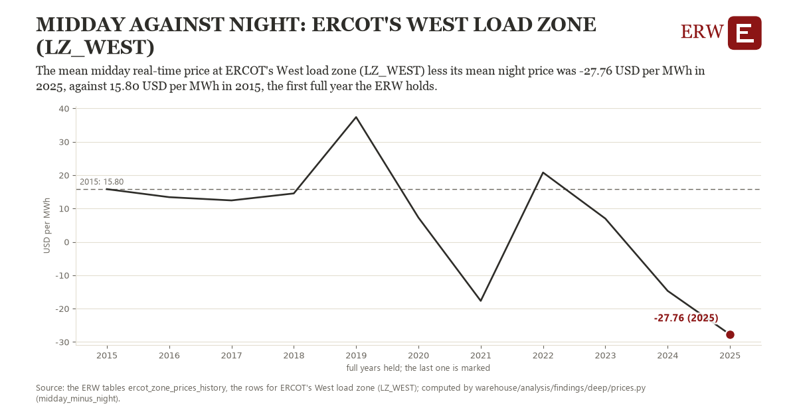

# Midday against night: ERCOT's West load zone (LZ_WEST)

Draft `scan-deep-fafffdc2c9f0` of the findings hunt over the whole warehouse (chain 164), 2026-11-06. State: draft, not reviewed. Review at `/internal/findings`.

**The finding.** The mean midday real-time price at ERCOT's West load zone (LZ_WEST) less its mean night price was -27.76 USD per MWh in 2025, against 15.80 USD per MWh in 2015, the first full year the ERW holds.

**The figure by full year** (USD per MWh): 2015: 15.80, 2016: 13.39, 2017: 12.42, 2018: 14.51, 2019: 37.39, 2020: 7.27, 2021: -17.69, 2022: 20.78, 2023: 6.97, 2024: -14.70, 2025: -27.76.

**The tables and rows.** `ercot_zone_prices_history`; the rows for ERCOT's West load zone (LZ_WEST), region key `ercot_LZ_WEST` (the card's `hunt.region`), years 2015 to 2025. The yearly values: `midday-minus-night-ercot-lz-west.csv`.

**Its strength.** The change is 1.66 typical yearly moves (a typical move is 26.29 USD per MWh, 1.4826 times the median absolute change between full years). Holds in more than one year: 8 of the 10 full years after 2015 lie below 2015's value. Survives a change of window: from 2016 to 2025 the change is -41.16, from 2015 to 2024 it is -30.49. Sample large enough: 2015 holds 8,760 and 2025 holds 8,760 observations; the floor is 8,000. Half the change remains without the first year: from 2016 to 2025 the change is -41.16, 94.5 percent of the change from 2015. At least one typical yearly move: the change is 1.66 typical yearly moves (26.29 USD per MWh a year, the median move between full years); the floor is 1.

**Its limits.** Nominal dollars; a difference of two means, each of which a few scarcity hours can move.

**Reproduce.** `python midday-minus-night-ercot-lz-west.reproduce.py <the table's CSV>` and `do midday-minus-night-ercot-lz-west.reproduce.do` (Stata) recompute the figures by year from the tables as the public downloads hold them; each names the expected values at its top.
