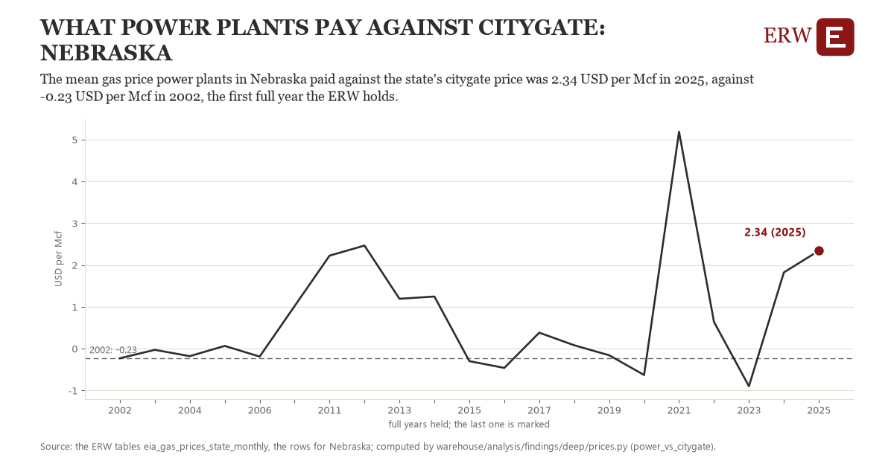

# What power plants pay against citygate: Nebraska

Draft `scan-deep-8686ad3a7888` of the findings hunt over the whole warehouse (chain 164), 2026-11-06. State: draft, not reviewed. Review at `/internal/findings`.

**The finding.** The mean gas price power plants in Nebraska paid against the state's citygate price was 2.34 USD per Mcf in 2025, against -0.23 USD per Mcf in 2002, the first full year the ERW holds.

**The figure by full year** (USD per Mcf): 2002: -0.23, 2003: -0.03, 2004: -0.18, 2005: 0.07, 2006: -0.19, 2007: 1.02, 2011: 2.23, 2012: 2.47, 2013: 1.19, 2014: 1.25, 2015: -0.30, 2016: -0.46, 2017: 0.38, 2018: 0.08, 2019: -0.16, 2020: -0.63, 2021: 5.19, 2022: 0.64, 2023: -0.90, 2024: 1.82, 2025: 2.34.

**The tables and rows.** `eia_gas_prices_state_monthly`; the rows for Nebraska, region key `state_pow_NE` (the card's `hunt.region`), years 2002 to 2025. The yearly values: `power-vs-citygate-state-pow-ne.csv`.

**Its strength.** The change is 3.51 typical yearly moves (a typical move is 0.73 USD per Mcf, 1.4826 times the median absolute change between full years). Holds in more than one year: 16 of the 20 full years after 2002 lie above 2002's value. Survives a change of window: from 2003 to 2025 the change is 2.37, from 2002 to 2024 it is 2.05. Sample large enough: 2002 holds 12 and 2025 holds 11 observations; the floor is 10. Half the change remains without the first year: from 2003 to 2025 the change is 2.37, 92.1 percent of the change from 2002. At least one typical yearly move: the change is 3.51 typical yearly moves (0.73 USD per Mcf a year, the median move between full years); the floor is 1.

**Its limits.** Nominal dollars per thousand cubic feet; EIA withholds many states' power-plant months, so a state's mean rests on the months it shows.

**Reproduce.** `python power-vs-citygate-state-pow-ne.reproduce.py <the table's CSV>` and `do power-vs-citygate-state-pow-ne.reproduce.do` (Stata) recompute the figures by year from the tables as the public downloads hold them; each names the expected values at its top.
