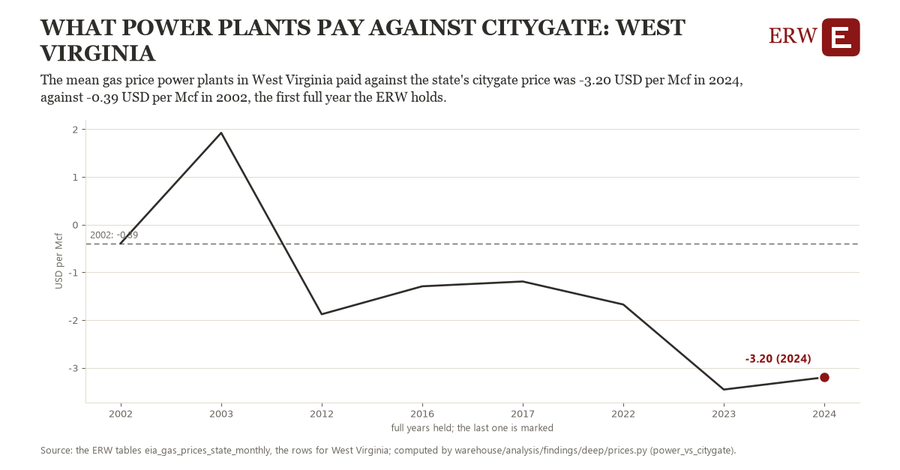

# What power plants pay against citygate: West Virginia

Draft `scan-deep-3e515c514c2d` of the findings hunt over the whole warehouse (chain 164), 2026-11-06. State: draft, not reviewed. Review at `/internal/findings`.

**The finding.** The mean gas price power plants in West Virginia paid against the state's citygate price was -3.20 USD per Mcf in 2024, against -0.39 USD per Mcf in 2002, the first full year the ERW holds.

**The figure by full year** (USD per Mcf): 2002: -0.39, 2003: 1.92, 2012: -1.88, 2016: -1.29, 2017: -1.19, 2022: -1.67, 2023: -3.46, 2024: -3.20.

**The tables and rows.** `eia_gas_prices_state_monthly`; the rows for West Virginia, region key `state_pow_WV` (the card's `hunt.region`), years 2002 to 2024. The yearly values: `power-vs-citygate-state-pow-wv.csv`.

**Its strength.** The change is 3.24 typical yearly moves (a typical move is 0.87 USD per Mcf, 1.4826 times the median absolute change between full years). Holds in more than one year: 6 of the 7 full years after 2002 lie below 2002's value. Survives a change of window: from 2003 to 2024 the change is -5.12, from 2002 to 2023 it is -3.06. Sample large enough: 2002 holds 12 and 2024 holds 12 observations; the floor is 10. Half the change remains without the first year: from 2003 to 2024 the change is -5.12, 182.4 percent of the change from 2002. At least one typical yearly move: the change is 3.24 typical yearly moves (0.87 USD per Mcf a year, the median move between full years); the floor is 1.

**Its limits.** Nominal dollars per thousand cubic feet; EIA withholds many states' power-plant months, so a state's mean rests on the months it shows.

**Reproduce.** `python power-vs-citygate-state-pow-wv.reproduce.py <the table's CSV>` and `do power-vs-citygate-state-pow-wv.reproduce.do` (Stata) recompute the figures by year from the tables as the public downloads hold them; each names the expected values at its top.
