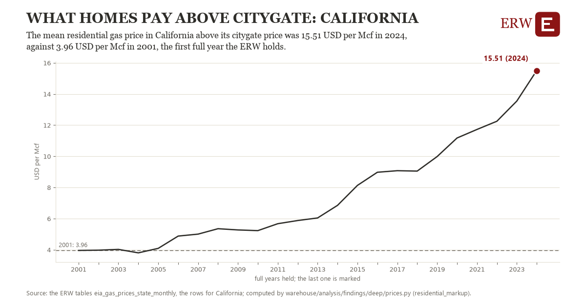

# What homes pay above citygate: California

Draft `scan-deep-36df813be89c` of the findings hunt over the whole warehouse (chain 164), 2026-11-06. State: draft, not reviewed. Review at `/internal/findings`.

**The finding.** The mean residential gas price in California above its citygate price was 15.51 USD per Mcf in 2024, against 3.96 USD per Mcf in 2001, the first full year the ERW holds.

**The figure by full year** (USD per Mcf): 2001: 3.96, 2002: 3.97, 2003: 4.03, 2004: 3.80, 2005: 4.09, 2006: 4.88, 2007: 5.00, 2008: 5.35, 2009: 5.27, 2010: 5.23, 2011: 5.67, 2012: 5.88, 2013: 6.04, 2014: 6.85, 2015: 8.13, 2016: 8.98, 2017: 9.08, 2018: 9.05, 2019: 9.98, 2020: 11.18, 2021: 11.72, 2022: 12.25, 2023: 13.55, 2024: 15.51.

**The tables and rows.** `eia_gas_prices_state_monthly`; the rows for California, region key `state_res_CA` (the card's `hunt.region`), years 2001 to 2024. The yearly values: `residential-markup-state-res-ca.csv`.

**Its strength.** The change is 22.42 typical yearly moves (a typical move is 0.52 USD per Mcf, 1.4826 times the median absolute change between full years). Holds in more than one year: 22 of the 23 full years after 2001 lie above 2001's value. Survives a change of window: from 2002 to 2024 the change is 11.53, from 2001 to 2023 it is 9.59. Sample large enough: 2001 holds 12 and 2024 holds 12 observations; the floor is 10. Half the change remains without the first year: from 2002 to 2024 the change is 11.53, 99.9 percent of the change from 2001. At least one typical yearly move: the change is 22.42 typical yearly moves (0.52 USD per Mcf a year, the median move between full years); the floor is 1.

**Its limits.** Nominal dollars per thousand cubic feet; a mean of months, not weighted by the gas each month delivered, and EIA withholds some months for some states.

**Reproduce.** `python residential-markup-state-res-ca.reproduce.py <the table's CSV>` and `do residential-markup-state-res-ca.reproduce.do` (Stata) recompute the figures by year from the tables as the public downloads hold them; each names the expected values at its top.
