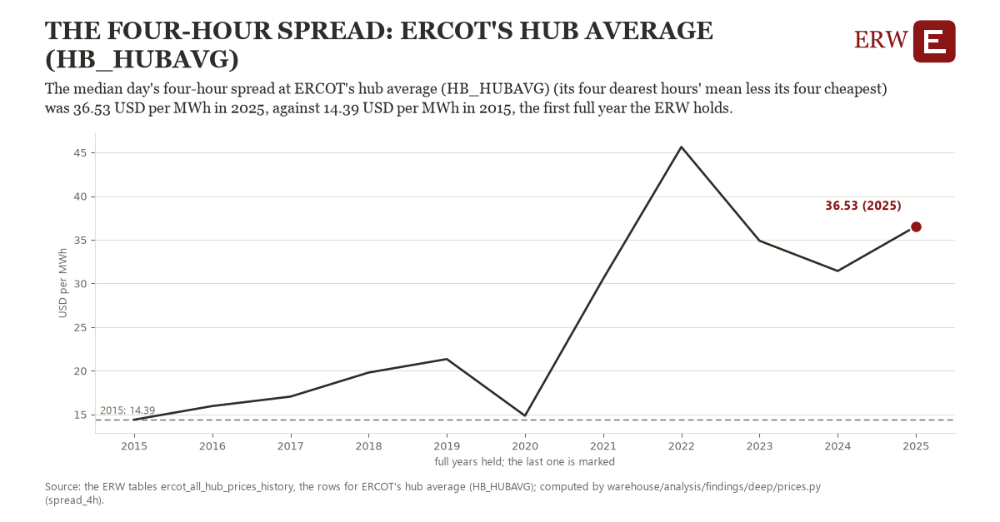

# The four-hour spread: ERCOT's hub average (HB_HUBAVG)

Draft `scan-deep-e6952da61753` of the findings hunt over the whole warehouse (chain 164), 2026-11-06. State: draft, not reviewed. Review at `/internal/findings`.

**The finding.** The median day's four-hour spread at ERCOT's hub average (HB_HUBAVG) (its four dearest hours' mean less its four cheapest) was 36.53 USD per MWh in 2025, against 14.39 USD per MWh in 2015, the first full year the ERW holds.

**The figure by full year** (USD per MWh): 2015: 14.39, 2016: 15.95, 2017: 17.03, 2018: 19.79, 2019: 21.33, 2020: 14.84, 2021: 30.53, 2022: 45.63, 2023: 34.88, 2024: 31.42, 2025: 36.53.

**The tables and rows.** `ercot_all_hub_prices_history`; the rows for ERCOT's hub average (HB_HUBAVG), region key `ercot_HB_HUBAVG` (the card's `hunt.region`), years 2015 to 2025. The yearly values: `spread-4h-ercot-hb-hubavg.csv`.

**Its strength.** The change is 3.49 typical yearly moves (a typical move is 6.35 USD per MWh, 1.4826 times the median absolute change between full years). Holds in more than one year: 10 of the 10 full years after 2015 lie above 2015's value. Survives a change of window: from 2016 to 2025 the change is 20.58, from 2015 to 2024 it is 17.03. Sample large enough: 2015 holds 365 and 2025 holds 365 observations; the floor is 330. Half the change remains without the first year: from 2016 to 2025 the change is 20.58, 92.9 percent of the change from 2015. At least one typical yearly move: the change is 3.49 typical yearly moves (6.35 USD per MWh a year, the median move between full years); the floor is 1.

**Its limits.** Nominal dollars; the hours need not be consecutive, so a four-hour battery could capture the spread only in part, before losses.

**Reproduce.** `python spread-4h-ercot-hb-hubavg.reproduce.py <the table's CSV>` and `do spread-4h-ercot-hb-hubavg.reproduce.do` (Stata) recompute the figures by year from the tables as the public downloads hold them; each names the expected values at its top.
