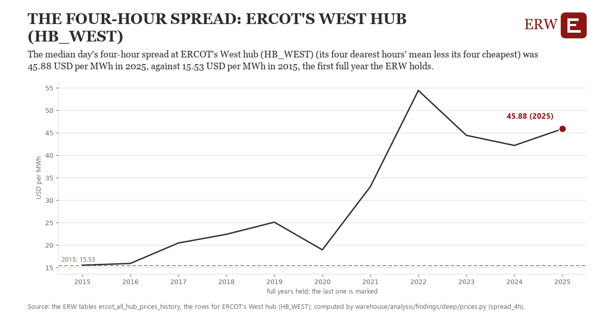

# The four-hour spread: ERCOT's West hub (HB_WEST)

Draft `scan-deep-0ffe99affaf3` of the findings hunt over the whole warehouse (chain 164), 2026-11-06. State: draft, not reviewed. Review at `/internal/findings`.

**The finding.** The median day's four-hour spread at ERCOT's West hub (HB_WEST) (its four dearest hours' mean less its four cheapest) was 45.88 USD per MWh in 2025, against 15.53 USD per MWh in 2015, the first full year the ERW holds.

**The figure by full year** (USD per MWh): 2015: 15.53, 2016: 15.93, 2017: 20.47, 2018: 22.42, 2019: 25.11, 2020: 18.96, 2021: 33.02, 2022: 54.42, 2023: 44.44, 2024: 42.18, 2025: 45.88.

**The tables and rows.** `ercot_all_hub_prices_history`; the rows for ERCOT's West hub (HB_WEST), region key `ercot_HB_WEST` (the card's `hunt.region`), years 2015 to 2025. The yearly values: `spread-4h-ercot-hb-west.csv`.

**Its strength.** The change is 4.97 typical yearly moves (a typical move is 6.11 USD per MWh, 1.4826 times the median absolute change between full years). Holds in more than one year: 10 of the 10 full years after 2015 lie above 2015's value. Survives a change of window: from 2016 to 2025 the change is 29.95, from 2015 to 2024 it is 26.65. Sample large enough: 2015 holds 365 and 2025 holds 365 observations; the floor is 330. Half the change remains without the first year: from 2016 to 2025 the change is 29.95, 98.7 percent of the change from 2015. At least one typical yearly move: the change is 4.97 typical yearly moves (6.11 USD per MWh a year, the median move between full years); the floor is 1.

**Its limits.** Nominal dollars; the hours need not be consecutive, so a four-hour battery could capture the spread only in part, before losses.

**Reproduce.** `python spread-4h-ercot-hb-west.reproduce.py <the table's CSV>` and `do spread-4h-ercot-hb-west.reproduce.do` (Stata) recompute the figures by year from the tables as the public downloads hold them; each names the expected values at its top.
