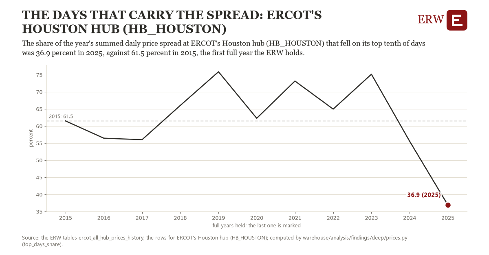

# The days that carry the spread: ERCOT's Houston hub (HB_HOUSTON)

Draft `scan-deep-992ff5bf34d9` of the findings hunt over the whole warehouse (chain 164), 2026-11-06. State: draft, not reviewed. Review at `/internal/findings`.

**The finding.** The share of the year's summed daily price spread at ERCOT's Houston hub (HB_HOUSTON) that fell on its top tenth of days was 36.9 percent in 2025, against 61.5 percent in 2015, the first full year the ERW holds.

**The figure by full year** (percent): 2015: 61.5, 2016: 56.5, 2017: 56.0, 2018: 66.0, 2019: 75.9, 2020: 62.3, 2021: 73.2, 2022: 65.0, 2023: 75.2, 2024: 55.5, 2025: 36.9.

**The tables and rows.** `ercot_all_hub_prices_history`; the rows for ERCOT's Houston hub (HB_HOUSTON), region key `ercot_HB_HOUSTON` (the card's `hunt.region`), years 2015 to 2025. The yearly values: `top-days-share-ercot-hb-houston.csv`.

**Its strength.** The change is 1.64 typical yearly moves (a typical move is 15.0 percent, 1.4826 times the median absolute change between full years). Holds in more than one year: 4 of the 10 full years after 2015 lie below 2015's value. Survives a change of window: from 2016 to 2025 the change is -19.5, from 2015 to 2024 it is -5.9. Sample large enough: 2015 holds 365 and 2025 holds 365 observations; the floor is 330. Half the change remains without the first year: from 2016 to 2025 the change is -19.5, 79.5 percent of the change from 2015. At least one typical yearly move: the change is 1.64 typical yearly moves (15.0 percent a year, the median move between full years); the floor is 1.

**Its limits.** A share of a sum of daily spreads in one hour each; it says how concentrated the spread is, not how much any asset earned.

**Reproduce.** `python top-days-share-ercot-hb-houston.reproduce.py <the table's CSV>` and `do top-days-share-ercot-hb-houston.reproduce.do` (Stata) recompute the figures by year from the tables as the public downloads hold them; each names the expected values at its top.
