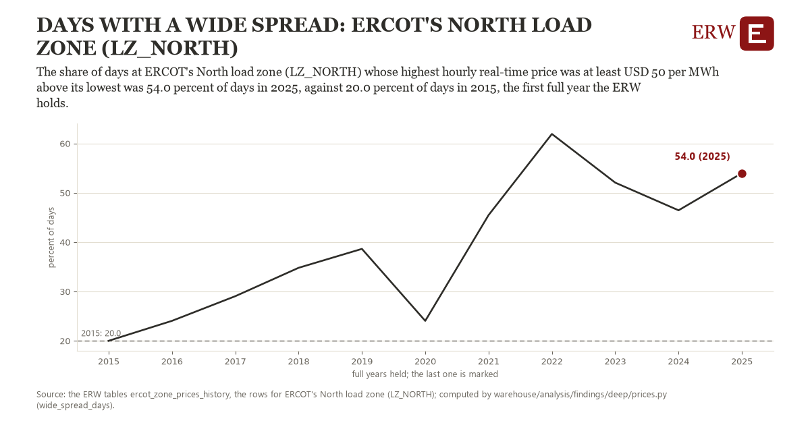

# Days with a wide spread: ERCOT's North load zone (LZ_NORTH)

Draft `scan-deep-e9841ce1dca1` of the findings hunt over the whole warehouse (chain 164), 2026-11-06. State: draft, not reviewed. Review at `/internal/findings`.

**The finding.** The share of days at ERCOT's North load zone (LZ_NORTH) whose highest hourly real-time price was at least USD 50 per MWh above its lowest was 54.0 percent of days in 2025, against 20.0 percent of days in 2015, the first full year the ERW holds.

**The figure by full year** (percent of days): 2015: 20.0, 2016: 24.0, 2017: 29.0, 2018: 34.8, 2019: 38.6, 2020: 24.0, 2021: 45.5, 2022: 61.9, 2023: 52.1, 2024: 46.4, 2025: 54.0.

**The tables and rows.** `ercot_zone_prices_history`; the rows for ERCOT's North load zone (LZ_NORTH), region key `ercot_LZ_NORTH` (the card's `hunt.region`), years 2015 to 2025. The yearly values: `wide-spread-days-ercot-lz-north.csv`.

**Its strength.** The change is 3.45 typical yearly moves (a typical move is 9.8 percent of days, 1.4826 times the median absolute change between full years). Holds in more than one year: 10 of the 10 full years after 2015 lie above 2015's value. Survives a change of window: from 2016 to 2025 the change is 29.9, from 2015 to 2024 it is 26.4. Sample large enough: 2015 holds 365 and 2025 holds 365 observations; the floor is 330. Half the change remains without the first year: from 2016 to 2025 the change is 29.9, 88.1 percent of the change from 2015. At least one typical yearly move: the change is 3.45 typical yearly moves (9.8 percent of days a year, the median move between full years); the floor is 1.

**Its limits.** A nominal line, not adjusted for inflation: the same real spread crosses it more easily in a later year.

**Reproduce.** `python wide-spread-days-ercot-lz-north.reproduce.py <the table's CSV>` and `do wide-spread-days-ercot-lz-north.reproduce.do` (Stata) recompute the figures by year from the tables as the public downloads hold them; each names the expected values at its top.
