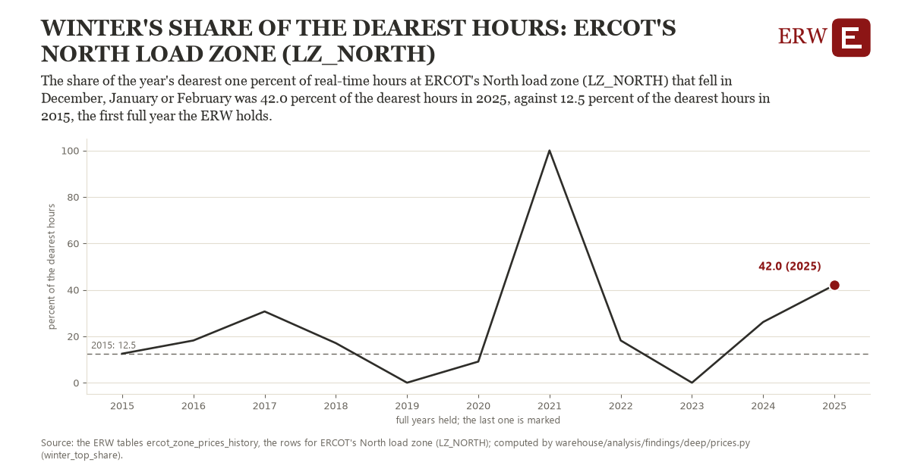

# Winter's share of the dearest hours: ERCOT's North load zone (LZ_NORTH)

Draft `scan-deep-7bfd2eb8c1b9` of the findings hunt over the whole warehouse (chain 164), 2026-11-06. State: draft, not reviewed. Review at `/internal/findings`.

**The finding.** The share of the year's dearest one percent of real-time hours at ERCOT's North load zone (LZ_NORTH) that fell in December, January or February was 42.0 percent of the dearest hours in 2025, against 12.5 percent of the dearest hours in 2015, the first full year the ERW holds.

**The figure by full year** (percent of the dearest hours): 2015: 12.5, 2016: 18.2, 2017: 30.7, 2018: 17.0, 2019: 0.0, 2020: 9.1, 2021: 100.0, 2022: 18.2, 2023: 0.0, 2024: 26.1, 2025: 42.0.

**The tables and rows.** `ercot_zone_prices_history`; the rows for ERCOT's North load zone (LZ_NORTH), region key `ercot_LZ_NORTH` (the card's `hunt.region`), years 2015 to 2025. The yearly values: `winter-top-share-ercot-lz-north.csv`.

**Its strength.** The change is 1.21 typical yearly moves (a typical move is 24.4 percent of the dearest hours, 1.4826 times the median absolute change between full years). Holds in more than one year: 7 of the 10 full years after 2015 lie above 2015's value. Survives a change of window: from 2016 to 2025 the change is 23.9, from 2015 to 2024 it is 13.6. Sample large enough: 2015 holds 8,760 and 2025 holds 8,760 observations; the floor is 8,000. Half the change remains without the first year: from 2016 to 2025 the change is 23.9, 80.8 percent of the change from 2015. At least one typical yearly move: the change is 1.21 typical yearly moves (24.4 percent of the dearest hours a year, the median move between full years); the floor is 1.

**Its limits.** About 88 hours a year: one cold spell can carry a year, and the year's December is not the same winter as its January.

**Reproduce.** `python winter-top-share-ercot-lz-north.reproduce.py <the table's CSV>` and `do winter-top-share-ercot-lz-north.reproduce.do` (Stata) recompute the figures by year from the tables as the public downloads hold them; each names the expected values at its top.
