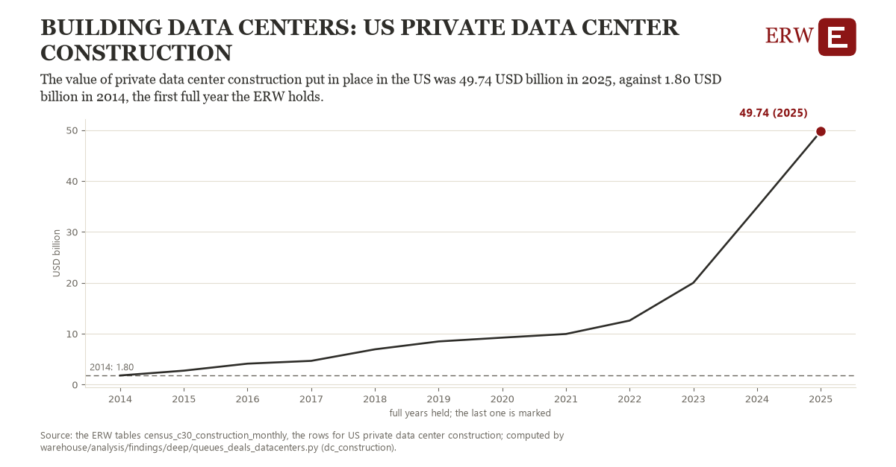

# Building data centers: US private data center construction

Draft `scan-deep-dd585d3c607b` of the findings hunt over the whole warehouse (chain 164), 2026-11-06. State: draft, not reviewed. Review at `/internal/findings`.

**The finding.** The value of private data center construction put in place in the US was 49.74 USD billion in 2025, against 1.80 USD billion in 2014, the first full year the ERW holds.

**The figure by full year** (USD billion): 2014: 1.80, 2015: 2.75, 2016: 4.12, 2017: 4.67, 2018: 6.93, 2019: 8.48, 2020: 9.23, 2021: 9.95, 2022: 12.58, 2023: 20.00, 2024: 34.80, 2025: 49.74.

**The tables and rows.** `census_c30_construction_monthly`; the rows for US private data center construction, region key `us_dc_build` (the card's `hunt.region`), years 2014 to 2025. The yearly values: `dc-construction-us-dc-build.csv`.

**Its strength.** The change is 20.86 typical yearly moves (a typical move is 2.30 USD billion, 1.4826 times the median absolute change between full years). Holds in more than one year: 11 of the 11 full years after 2014 lie above 2014's value. Survives a change of window: from 2015 to 2025 the change is 46.99, from 2014 to 2024 it is 33.00. Sample large enough: 2014 holds 12 and 2025 holds 12 observations; the floor is 11. Half the change remains without the first year: from 2015 to 2025 the change is 46.99, 98.0 percent of the change from 2014. At least one typical yearly move: the change is 20.86 typical yearly moves (2.30 USD billion a year, the median move between full years); the floor is 1.

**Its limits.** The Census Bureau's value put in place, nominal dollars, not seasonally adjusted; the latest months are preliminary and are revised.

**Reproduce.** `python dc-construction-us-dc-build.reproduce.py <the table's CSV>` and `do dc-construction-us-dc-build.reproduce.do` (Stata) recompute the figures by year from the tables as the public downloads hold them; each names the expected values at its top.
