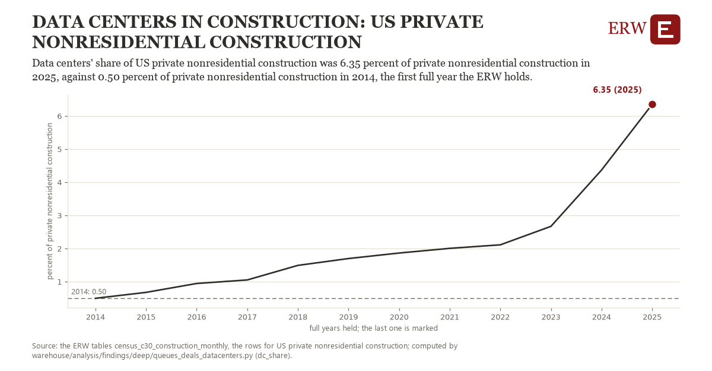

# Data centers in construction: US private nonresidential construction

Draft `scan-deep-a1a72bdb3de0` of the findings hunt over the whole warehouse (chain 164), 2026-11-06. State: draft, not reviewed. Review at `/internal/findings`.

**The finding.** Data centers' share of US private nonresidential construction was 6.35 percent of private nonresidential construction in 2025, against 0.50 percent of private nonresidential construction in 2014, the first full year the ERW holds.

**The figure by full year** (percent of private nonresidential construction): 2014: 0.50, 2015: 0.68, 2016: 0.94, 2017: 1.05, 2018: 1.49, 2019: 1.70, 2020: 1.86, 2021: 2.00, 2022: 2.11, 2023: 2.67, 2024: 4.37, 2025: 6.35.

**The tables and rows.** `census_c30_construction_monthly`; the rows for US private nonresidential construction, region key `us_dc_share` (the card's `hunt.region`), years 2014 to 2025. The yearly values: `dc-share-us-dc-share.csv`.

**Its strength.** The change is 19.09 typical yearly moves (a typical move is 0.31 percent of private nonresidential construction, 1.4826 times the median absolute change between full years). Holds in more than one year: 11 of the 11 full years after 2014 lie above 2014's value. Survives a change of window: from 2015 to 2025 the change is 5.67, from 2014 to 2024 it is 3.87. Sample large enough: 2014 holds 12 and 2025 holds 12 observations; the floor is 11. Half the change remains without the first year: from 2015 to 2025 the change is 5.67, 97.0 percent of the change from 2014. At least one typical yearly move: the change is 19.09 typical yearly moves (0.31 percent of private nonresidential construction a year, the median move between full years); the floor is 1.

**Its limits.** The Census Bureau's value put in place, nominal dollars, not seasonally adjusted; the latest months are preliminary and are revised.

**Reproduce.** `python dc-share-us-dc-share.reproduce.py <the table's CSV>` and `do dc-share-us-dc-share.reproduce.do` (Stata) recompute the figures by year from the tables as the public downloads hold them; each names the expected values at its top.
