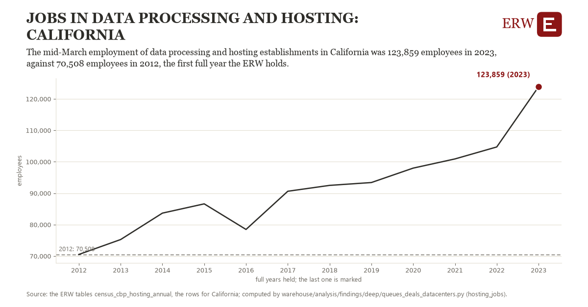

# Jobs in data processing and hosting: California

Draft `scan-deep-4b922e23058f` of the findings hunt over the whole warehouse (chain 164), 2026-11-06. State: draft, not reviewed. Review at `/internal/findings`.

**The finding.** The mid-March employment of data processing and hosting establishments in California was 123,859 employees in 2023, against 70,508 employees in 2012, the first full year the ERW holds.

**The figure by full year** (employees): 2012: 70,508, 2013: 75,253, 2014: 83,660, 2015: 86,606, 2016: 78,464, 2017: 90,616, 2018: 92,485, 2019: 93,391, 2020: 97,978, 2021: 100,903, 2022: 104,709, 2023: 123,859.

**The tables and rows.** `census_cbp_hosting_annual`; the rows for California, region key `jobs518_CA` (the card's `hunt.region`), years 2012 to 2023. The yearly values: `hosting-jobs-jobs518-ca.csv`.

**Its strength.** The change is 7.84 typical yearly moves (a typical move is 6,801 employees, 1.4826 times the median absolute change between full years). Holds in more than one year: 11 of the 11 full years after 2012 lie above 2012's value. Survives a change of window: from 2013 to 2023 the change is 48,606, from 2012 to 2022 it is 34,201. Sample large enough: 2012 holds 1 and 2023 holds 1 observations; the floor is 1. Half the change remains without the first year: from 2013 to 2023 the change is 48,606, 91.1 percent of the change from 2012. At least one typical yearly move: the change is 7.84 typical yearly moves (6,801 employees a year, the median move between full years); the floor is 1.

**Its limits.** County Business Patterns counts establishments by their main activity, so a data center run inside another firm's establishment is not in it; the Census Bureau adds noise to protect respondents, and NAICS 518210's definition widened with the 2022 codes.

**Reproduce.** `python hosting-jobs-jobs518-ca.reproduce.py <the table's CSV>` and `do hosting-jobs-jobs518-ca.reproduce.do` (Stata) recompute the figures by year from the tables as the public downloads hold them; each names the expected values at its top.
