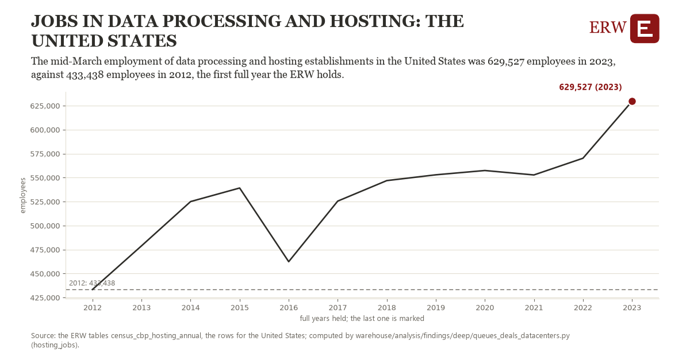

# Jobs in data processing and hosting: the United States

Draft `scan-deep-5ef3c6f444d9` of the findings hunt over the whole warehouse (chain 164), 2026-11-06. State: draft, not reviewed. Review at `/internal/findings`.

**The finding.** The mid-March employment of data processing and hosting establishments in the United States was 629,527 employees in 2023, against 433,438 employees in 2012, the first full year the ERW holds.

**The figure by full year** (employees): 2012: 433,438, 2013: 478,933, 2014: 525,043, 2015: 539,171, 2016: 462,391, 2017: 525,528, 2018: 546,889, 2019: 552,937, 2020: 557,409, 2021: 552,789, 2022: 570,188, 2023: 629,527.

**The tables and rows.** `census_cbp_hosting_annual`; the rows for the United States, region key `jobs518_US` (the card's `hunt.region`), years 2012 to 2023. The yearly values: `hosting-jobs-jobs518-us.csv`.

**Its strength.** The change is 6.19 typical yearly moves (a typical move is 31,670 employees, 1.4826 times the median absolute change between full years). Holds in more than one year: 11 of the 11 full years after 2012 lie above 2012's value. Survives a change of window: from 2013 to 2023 the change is 150,594, from 2012 to 2022 it is 136,750. Sample large enough: 2012 holds 1 and 2023 holds 1 observations; the floor is 1. Half the change remains without the first year: from 2013 to 2023 the change is 150,594, 76.8 percent of the change from 2012. At least one typical yearly move: the change is 6.19 typical yearly moves (31,670 employees a year, the median move between full years); the floor is 1.

**Its limits.** County Business Patterns counts establishments by their main activity, so a data center run inside another firm's establishment is not in it; the Census Bureau adds noise to protect respondents, and NAICS 518210's definition widened with the 2022 codes.

**Reproduce.** `python hosting-jobs-jobs518-us.reproduce.py <the table's CSV>` and `do hosting-jobs-jobs518-us.reproduce.do` (Stata) recompute the figures by year from the tables as the public downloads hold them; each names the expected values at its top.
